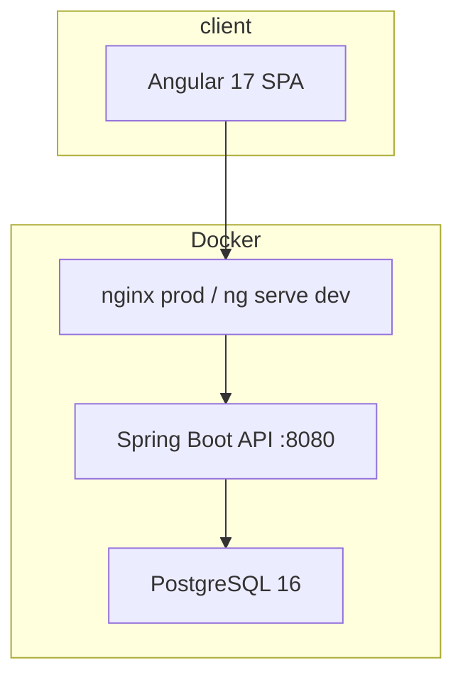

# Enterprise Resource Management — Full Technical Audit Report

**Stack:** Spring Boot 4.0.1 / Java 17 · Angular 17.3 · PostgreSQL 16 · Flyway · Docker · GitHub Actions  
**Scope:** Monorepo (`backend/`, `frontend/`, `docker/`, CI/CD)  
**Date:** 2026-06-27  
**Status:** Baseline audit with post-remediation progress noted in §18

---

## Table of contents

1. [Project overview & architecture](#1-project-overview--architecture)
2. [Backend Spring Boot audit](#2-backend-spring-boot-audit)
3. [Java code quality audit](#3-java-code-quality-audit)
4. [Spring Boot best practices](#4-spring-boot-best-practices)
5. [REST API audit](#5-rest-api-audit)
6. [Security audit](#6-security-audit)
7. [Database audit](#7-database-audit)
8. [Angular audit](#8-angular-audit)
9. [Frontend performance](#9-frontend-performance)
10. [Backend performance](#10-backend-performance)
11. [Testing audit](#11-testing-audit)
12. [CI/CD audit](#12-cicd-audit)
13. [Deployment audit](#13-deployment-audit)
14. [Logging & monitoring](#14-logging--monitoring)
15. [Dependency security](#15-dependency-security)
16. [Documentation audit](#16-documentation-audit)
17. [Technical debt report](#17-technical-debt-report)
18. [Progress since audit](#18-progress-since-audit)
19. [Final summary & scores](#19-final-summary--scores)

---

## 1. Project overview & architecture

### Current architecture



| Dimension | Assessment |
|-----------|------------|
| **Style** | Modular monolith — single API + single SPA |
| **Multi-tenancy** | Organization-scoped (`organization_id` on core tables) |
| **Backend layers** | Controller → Application Service → Domain Service → Repository |
| **Frontend** | Feature-based, 100% standalone components, lazy-loaded routes |
| **Suitability** | Appropriate for internal ERM at current scale |

### Strengths

- Clear frontend/backend separation with versioned REST API (`/api/v1/organizations/{orgId}/...`)
- DTOs for API contracts; entities not exposed directly
- Domain services (`*DomainService`) for business rules
- Flyway migrations with Hibernate `ddl-auto=validate`
- `open-in-view=false`

### Anti-patterns & coupling

| Issue | Severity | Location |
|-------|----------|----------|
| Inconsistent package roots (`com.example` vs `com.company`) | MEDIUM | `ErmBackendApplication`, `com.company.erm.*` |
| Controller bypasses service layer | MEDIUM | `ProjectController` → `ProjectRepository` |
| Mapper performs DB reads | MEDIUM | `EmployeeMapper` (single-entity path) |
| God service | HIGH | `ReportingService` (~771 lines) |
| Duplicate API surface | MEDIUM | `QuickActionsController` vs versioned controllers |
| Misplaced config | MEDIUM | `backend/application.yml` not on classpath |

### Recommended architecture improvements

1. Split `ReportingService` into focused report services
2. Enforce strict layering (controllers never touch repositories)
3. Unify package naming under `com.company.erm`
4. Add complete `application-prod` profile under `src/main/resources/`
5. Version all APIs under `/api/v1` (settings, notifications, quick actions)

---

## 2. Backend Spring Boot audit

### Package structure

```
com.company.erm/
├── controller/     (16 REST controllers, ~75 endpoints)
├── service/        (23 services + 7 domain services)
├── repository/     (12 JPA repositories)
├── entity/         (14 entities)
├── dto/            (52 DTOs)
├── mapper/         (8 manual mappers)
├── security/       (JWT, filters, PermissionChecker)
├── config/         (JPA, Flyway, JWT)
└── exception/      (GlobalExceptionHandler + typed exceptions)
```

### Large classes

| Class | Lines | Concern |
|-------|-------|---------|
| `ReportingService` | ~771 | God service |
| `SearchService` | ~429 | In-memory search |
| `TimeEntryService` | ~427 | Workflow + CRUD |
| `AuditLogService` | ~413 | Repetitive boilerplate |
| `LeaveRequestService` | ~404 | Workflow + CRUD |

---

## 3. Java code quality audit

| File | Problem | Severity | Solution |
|------|---------|----------|----------|
| `GlobalExceptionHandler` | `IllegalArgumentException` → 500 | MEDIUM | Map to 400/404 typed exceptions |
| `CustomUserDetailsService` | Duplicated load methods | LOW | Extract shared method |
| `AuditLogService` | Repetitive `log*()` methods | MEDIUM | Generic `log(AuditEvent)` |
| `PermissionChecker` | try/catch for control flow in `hasRole` | LOW | Direct query |
| Multiple services | Hardcoded role strings | MEDIUM | `enum RoleCode` |
| `QuickActionsController` | Controller auth only `isAuthenticated()` | MEDIUM | Align with v1 `@PreAuthorize` |

---

## 4. Spring Boot best practices

| Item | Value |
|------|-------|
| Spring Boot | 4.0.1 |
| Java | 17 |
| Build | Maven + JaCoCo (30% floor) |
| OpenAPI | SpringDoc 2.5.0 |

### Configuration

| Property | Status |
|----------|--------|
| `JWT_SECRET` required (no default) | Good |
| Default `DB_PASS` in properties | Risk if used in prod |
| `application-prod.properties` | Partial (demo data flag only) |
| Flyway | Enabled, V1–V12 |

---

## 5. REST API audit

### Quality

| Area | Status |
|------|--------|
| Validation | Good (`@Valid` on DTOs) |
| Error format | Consistent `ErrorResponse(code, details)` |
| Pagination | Partial (employees, time entries, leave, search) |
| OpenAPI | Present at `/swagger-ui/**` |

### Recommendations

1. Version all routes under `/api/v1`
2. Add rate limiting on `/auth/login`
3. Restrict Swagger to dev profile
4. Document pagination defaults in OpenAPI

---

## 6. Security audit

### Authentication

| Check | Finding | Severity |
|-------|---------|----------|
| Mechanism | Stateless JWT (JJWT 0.12.3) | OK |
| Token storage | `localStorage` | **HIGH** |
| Expiration | 24h, no refresh | MEDIUM |
| Password hashing | BCrypt | Good |

### Authorization

| Check | Finding | Severity |
|-------|---------|----------|
| Backend RBAC | `@PreAuthorize` + `PermissionChecker` | Good |
| Org isolation | `findByIdAndOrganizationId` + role checks | Good |
| Frontend role guard | Was bypassed in dev | **CRITICAL** (fixed — see §18) |

### Vulnerability summary (baseline)

| # | Issue | Severity |
|---|-------|----------|
| 1 | Frontend role guard bypass | CRITICAL |
| 2 | nginx strips `/api` in prod | CRITICAL |
| 3 | Prod compose missing DB/secrets | CRITICAL |
| 4 | Demo seed credentials in Flyway | CRITICAL (prod) |
| 5 | JWT in localStorage | HIGH |
| 6 | `AccessDeniedException` → 500 | HIGH |
| 7 | No refresh token | MEDIUM |
| 8 | Swagger public | MEDIUM |
| 9 | No login rate limiting | MEDIUM |
| 10 | No TLS in Docker | HIGH |

---

## 7. Database audit

### Design

- PostgreSQL, schema `erm`, UUID PKs, multi-tenant via `organization_id`
- Reasonable normalization; soft-delete via `is_active` / `archived`
- Flyway V1–V12; Hibernate `validate`

### Indexes

Good coverage on transactional tables. Core lookup indexes on `users` / `user_roles` were missing (addressed in V12 — see §18).

### Recommendations

1. Replace in-memory search with DB `ILIKE` or full-text search
2. Gate demo seed migration per environment
3. Add composite indexes for common report queries

---

## 8. Angular audit

| Aspect | Status |
|--------|--------|
| Standalone components | 100% |
| Feature organization | Feature-based (`features/*`) |
| Lazy loading | All features |
| State | Signals in services; no NgRx |
| Role guard | Was bypassed (fixed — see §18) |

### Issues

| Issue | Severity |
|-------|----------|
| No `OnPush` change detection | MEDIUM |
| Impure `TranslatePipe` | MEDIUM |
| ~50+ uncleaned `.subscribe()` calls | MEDIUM |
| Sidebar god component (~426 lines) | MEDIUM |
| Zero unit tests | HIGH |

---

## 9. Frontend performance

| Present | Missing |
|---------|---------|
| Lazy-loaded routes | `OnPush` |
| Event coalescing | `@defer` |
| Production bundle budgets | HTTP caching (`shareReplay`) |
| | Duplicate dashboard fetches |

---

## 10. Backend performance

| Issue | Severity |
|-------|----------|
| `ReportingService` JVM aggregation | HIGH |
| `SearchService` full-table load + filter | HIGH |
| No caching | MEDIUM |
| No async export jobs | MEDIUM |

---

## 11. Testing audit

| Type | Count | Quality |
|------|-------|---------|
| Backend unit | 2 service tests | Minimal |
| Backend integration | 3 controllers | Good pattern; many failures |
| Frontend unit | 0 | None |
| E2E | 0 | None |
| JaCoCo floor | 30% | Too low |

**Testing maturity: 2/10** (baseline)

---

## 12. CI/CD audit

| Workflow | Status |
|----------|--------|
| `ci.yml` | Maven test + npm lint/build |
| `docker-build.yml` | Builds images locally; `push: false` |

### Gaps

- No JaCoCo upload; no OWASP Dependency-Check
- No `npm audit` in CI
- Integration tests unstable
- No compose smoke test job

---

## 13. Deployment audit

| Item | Status |
|------|--------|
| Dev Docker | Full stack with hot reload |
| Prod Docker | Backend + frontend + DB (after fixes) |
| nginx API proxy | Was broken (fixed — see §18) |
| Healthchecks in compose | Missing |
| TLS | Missing |
| K8s manifests | Docs only |

---

## 14. Logging & monitoring

| Capability | Status |
|------------|--------|
| Logback file + console | Present |
| Actuator + Prometheus | Present |
| Structured JSON logs | Missing |
| Request/correlation IDs | Missing |
| Audit log persistence | Log-only, not DB |
| Centralized monitoring | Missing |

---

## 15. Dependency security

| Stack | Finding |
|-------|---------|
| Backend | No automated vulnerability scan in CI |
| Frontend | **87 npm advisories** (6 critical, 47 high); fix requires Angular 17 → 19 |

---

## 16. Documentation audit

| Document | Status |
|----------|--------|
| Root README | Good; referenced missing `docs/` |
| Backend / frontend docs | Present under `backend/docs/`, `frontend/doc/` |
| `env.example` | Was missing (fixed — see §18) |
| Architecture docs | Partial |
| This audit | Now in `docs/AUDIT_REPORT.md` |

---

## 17. Technical debt report

### Critical

| Problem | Location | Effort |
|---------|----------|--------|
| JWT in localStorage | `auth.service.ts` | 2–3d |
| Demo seed in all environments | Flyway V3 | 4h |
| No TLS in production | nginx, compose | 1–2d |
| Angular CVEs (17.x) | `package.json` | 1–2w upgrade |

### High

| Problem | Location | Effort |
|---------|----------|--------|
| `ReportingService` god class | `ReportingService.java` | 3–5d |
| Zero frontend tests | `frontend/` | 1–2w |
| Integration test failures | `backend/src/test/` | 2–3d |
| `SearchService` in-memory | `SearchService.java` | 2–3d |
| No Docker healthchecks | `docker/*.yml` | 4h |

### Medium

| Problem | Location | Effort |
|---------|----------|--------|
| No refresh tokens | Auth layer | 3–5d |
| No structured logging | Backend | 2–3d |
| Swagger in prod | `SecurityConfig.java` | 2h |
| OnPush / subscription cleanup | Frontend | 3–5d |

### Low

| Problem | Location | Effort |
|---------|----------|--------|
| Mixed DTO styles | `dto/` | 2d |
| Package naming | Bootstrap vs domain | 4h |
| Impure TranslatePipe | `translate.pipe.ts` | 4h |

---

## 18. Progress since audit

Remediation completed **2026-06-27** (same sprint as this document).

### Fixed

| Item | Files / notes |
|------|----------------|
| nginx `/api` proxy strips prefix | `frontend/docker/nginx.conf`, `environment.prod.ts` |
| Frontend role guard bypass | `frontend/src/app/core/guards/role.guard.ts` |
| Prod compose incomplete | `docker/docker-compose.yml` (DB, JWT, CORS) |
| Frontend prod Dockerfile needs local `dist/` | Multi-stage `frontend/docker/Dockerfile` |
| `AccessDeniedException` → 500 | `GlobalExceptionHandler.java` → 403 |
| Missing `env.example` | `env.example`, `backend/env.example`, `.gitignore` |
| CI `continue-on-error` on frontend | `.github/workflows/ci.yml` |
| Employee list N+1 | `EmployeeMapper.toResponsePage()`, `UserRoleRepository` batch query |
| Missing user/role indexes | `V12__add_user_lookup_indexes.sql` |
| Duplicate Bearer token | `api.service.ts` (interceptor only) |
| ESLint baseline | `.eslintrc.json`, `npm run lint` in CI |
| Demo org in production | `DemoDataCleanupRunner`, `application-prod.properties` |
| Dev Docker entrypoint conflict | `docker/docker-compose.dev.yml` `entrypoint: []` |
| Backend test infrastructure (partial) | `FlywayConfig` conditional, `TestJpaConfiguration`, `MockMvcTestConfiguration` |

### Partially fixed

| Item | Remaining |
|------|-----------|
| Demo seed credentials | V3 migration still runs; cleanup removes org in prod only |
| ESLint | Warnings only; no Angular template rules |
| Backend tests | 12 unit/context pass; ~17 integration tests still fail |
| CI quality gate | Lint + build pass; full `mvn test` still red |

---

## 19. Final summary & scores

### Health scores (baseline → after fixes)

| Dimension | Baseline | After fixes |
|-----------|----------|-------------|
| Architecture | 7 | 7 |
| Code quality | 6 | 6.5 |
| Security | 4 | **6** |
| Performance | 5 | 5.5 |
| Database | 7 | **7.5** |
| Testing | 2 | **3** |
| DevOps | 4 | **6** |
| Maintainability | 6 | 6.5 |
| **Overall** | **5.1** | **~6.0** |

### Top 10 improvements (ranked)

1. Fix integration test suite and raise CI bar
2. Angular 17 → 19 (security advisories)
3. TLS + Docker healthchecks for production
4. Move JWT out of localStorage / add refresh tokens
5. Split `ReportingService` and optimize `SearchService`
6. Add frontend unit tests + test runner
7. Gate or remove demo Flyway seed in production
8. Structured logging + correlation IDs
9. OWASP Dependency-Check + `npm audit` in CI
10. Restrict Swagger and add login rate limiting

### Senior developer recommendation

The codebase has a **solid modular monolith** foundation. Production blockers from the original audit (nginx, role guard, compose, build pipeline) are largely addressed. The path to production-grade now runs through **test stability**, **security hardening** (TLS, token storage, Angular upgrade), and **performance** (reporting/search). Target **4–6 weeks** for a credible production readiness milestone.

**Next document:** [IMPLEMENTATION_PLAN.md](./IMPLEMENTATION_PLAN.md)
