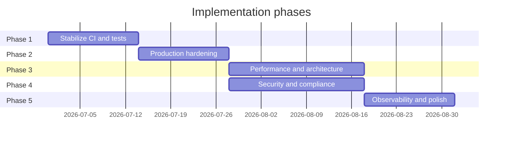

# ERM Platform — Implementation Plan

Phased roadmap for **remaining work** identified in [AUDIT_REPORT.md](./AUDIT_REPORT.md).  
Items already fixed in the remediation sprint are listed only in the audit (§18).

**Last updated:** 2026-06-27  
**Estimated total effort:** 8–12 weeks (1–2 developers)

---

## Overview

| Phase | Focus | Duration | Outcome |
|-------|--------|----------|---------|
| [Phase 1](#phase-1--stabilize-quality-gates) | Tests & CI | 1–2 weeks | Green CI, reliable regression signal |
| [Phase 2](#phase-2--production-hardening) | Deploy & ops | 1–2 weeks | Prod-ready Docker/K8s baseline |
| [Phase 3](#phase-3--performance--architecture) | Backend/frontend perf | 2–3 weeks | Dashboard/search at scale |
| [Phase 4](#phase-4--security--compliance) | Auth & dependencies | 2–3 weeks | Reduced attack surface |
| [Phase 5](#phase-5--observability--polish) | Logs, docs, debt | 1–2 weeks | Operable production system |

Phases 3 and 4 can overlap after Phase 2 completes.

---

## Phase 1 — Stabilize quality gates

**Goal:** CI fails only on real regressions. Developers trust `mvn test` and `npm run lint`.

**Duration:** 1–2 weeks  
**Priority:** P0

### Tasks

#### 1.1 Fix backend integration tests

| ID | Task | Owner | Effort | Files |
|----|------|-------|--------|-------|
| 1.1.1 | Fix JWT/role setup in `EmployeeControllerIntegrationTest` (403 vs 200 expectations) | Backend | 4h | `EmployeeControllerIntegrationTest.java` |
| 1.1.2 | Fix JWT/role setup in `ProjectControllerIntegrationTest` | Backend | 4h | `ProjectControllerIntegrationTest.java` |
| 1.1.3 | Align `AuthControllerIntegrationTest` inactive-user assertion with `BusinessException` message | Backend | 1h | `AuthControllerIntegrationTest.java` |
| 1.1.4 | Add test helper for authenticated `MockMvc` requests with correct `ROLE_*` authorities | Backend | 4h | `TestDataFactory` or new `SecurityTestHelper` |
| 1.1.5 | Run full `./mvnw test` in CI without exclusions | DevOps | 1h | `.github/workflows/ci.yml` |

**Acceptance criteria**

- [ ] `./mvnw test` passes locally and in CI (36/36 tests)
- [ ] Integration tests use consistent role codes (`ORG_ADMIN`, not `ADMIN`)

#### 1.2 Frontend test runner

| ID | Task | Owner | Effort | Files |
|----|------|-------|--------|-------|
| 1.2.1 | Add Karma or Jest via `ng add` / manual `angular.json` test target | Frontend | 4h | `angular.json`, `package.json` |
| 1.2.2 | Unit tests: `role.guard.ts` (auth, allow, deny) | Frontend | 2h | `role.guard.spec.ts` |
| 1.2.3 | Unit tests: `auth.interceptor.ts`, `error.interceptor.ts` | Frontend | 3h | `*.spec.ts` |
| 1.2.4 | Unit tests: `AuthService` (login, logout, `hasAnyRole`) | Frontend | 3h | `auth.service.spec.ts` |
| 1.2.5 | Add `npm test` to CI (fail on error) | DevOps | 1h | `ci.yml` |

**Acceptance criteria**

- [ ] `npm test` runs in CI with ≥4 spec files
- [ ] Role guard behavior covered by tests

#### 1.3 Raise backend coverage bar

| ID | Task | Owner | Effort | Files |
|----|------|-------|--------|-------|
| 1.3.1 | Add unit tests for `PermissionChecker` | Backend | 4h | `PermissionCheckerTest.java` |
| 1.3.2 | Add unit tests for `GlobalExceptionHandler` (403, 400, 500) | Backend | 2h | `GlobalExceptionHandlerTest.java` |
| 1.3.3 | Increase JaCoCo minimum from 30% → 50% | Backend | 1h | `pom.xml` |
| 1.3.4 | Upload JaCoCo report in CI (optional artifact) | DevOps | 2h | `ci.yml` |

**Acceptance criteria**

- [ ] JaCoCo floor ≥50% line coverage
- [ ] `PermissionChecker` and exception handler have dedicated tests

#### 1.4 Tighten ESLint

| ID | Task | Owner | Effort | Files |
|----|------|-------|--------|-------|
| 1.4.1 | Fix 15 unused-import warnings | Frontend | 2h | Various `*.ts` |
| 1.4.2 | Add `@angular-eslint` template rules (incremental) | Frontend | 4h | `.eslintrc.json` |
| 1.4.3 | Fail CI on ESLint errors (warnings allowed initially) | DevOps | 1h | `ci.yml` |

**Acceptance criteria**

- [ ] `npm run lint` exits 0 with ≤5 warnings

---

## Phase 2 — Production hardening

**Goal:** Deployable production stack with health probes, TLS path, and no demo credentials in prod.

**Duration:** 1–2 weeks  
**Priority:** P0–P1

### Tasks

#### 2.1 Docker & compose

| ID | Task | Owner | Effort | Files |
|----|------|-------|--------|-------|
| 2.1.1 | Add `healthcheck` to `db`, `backend`, `front` in compose files | DevOps | 3h | `docker/docker-compose.yml`, `docker-compose.dev.yml` |
| 2.1.2 | Use `depends_on: condition: service_healthy` for backend → db | DevOps | 1h | `docker-compose.yml` |
| 2.1.3 | Document prod env vars in `env.example` (secrets via `.env`, not committed) | DevOps | 1h | `env.example` |
| 2.1.4 | Add `backend/.dockerignore` | DevOps | 1h | `backend/.dockerignore` |
| 2.1.5 | Prod compose: use secrets file or env_file for `JWT_SECRET` (no inline defaults) | DevOps | 2h | `docker-compose.yml` |

**Acceptance criteria**

- [ ] `docker compose up` waits for DB healthy before starting backend
- [ ] `curl /actuator/health` returns UP within 90s of `up`

#### 2.2 TLS & reverse proxy

| ID | Task | Owner | Effort | Files |
|----|------|-------|--------|-------|
| 2.2.1 | Add TLS termination option (nginx ssl or Traefik) | DevOps | 1d | `frontend/docker/nginx.conf`, compose |
| 2.2.2 | Set `X-Forwarded-*` headers and document prod URL | DevOps | 2h | `nginx.conf` |
| 2.2.3 | Update `CORS_ALLOWED_ORIGINS` for production domain | Backend | 1h | `application-prod.properties` |

**Acceptance criteria**

- [ ] HTTPS documented and working in staging
- [ ] CORS restricted to production origin(s)

#### 2.3 Demo data & Flyway

| ID | Task | Owner | Effort | Files |
|----|------|-------|--------|-------|
| 2.3.1 | Move V3 seed to `db/migration/dev/` or use Flyway placeholders `${erm.demo.enabled}` | Backend | 4h | Flyway config, V3 script |
| 2.3.2 | Verify `DemoDataCleanupRunner` on prod profile startup | Backend | 2h | `DemoDataCleanupRunner.java` |
| 2.3.3 | Remove `password123` from README prod sections; keep dev-only | Docs | 1h | `README.md` |

**Acceptance criteria**

- [ ] Fresh prod deploy has no `admin@demo.com` user
- [ ] Dev deploy still has demo login

#### 2.4 CI/CD pipeline

| ID | Task | Owner | Effort | Files |
|----|------|-------|--------|-------|
| 2.4.1 | Push images to GHCR with SHA tags | DevOps | 4h | `docker-build.yml` |
| 2.4.2 | Add compose smoke test job (health + login) post-build | DevOps | 1d | `ci.yml` |
| 2.4.3 | Add OWASP Dependency-Check (Maven) | DevOps | 4h | `ci.yml`, `pom.xml` |
| 2.4.4 | Add `npm audit --audit-level=high` (non-blocking initially) | DevOps | 2h | `ci.yml` |

**Acceptance criteria**

- [ ] Images published to registry on `main` tag
- [ ] Dependency scan runs on every PR

---

## Phase 3 — Performance & architecture

**Goal:** Dashboard and search remain responsive with realistic data volumes.

**Duration:** 2–3 weeks  
**Priority:** P1

### Tasks

#### 3.1 Split ReportingService

| ID | Task | Owner | Effort | Files |
|----|------|-------|--------|-------|
| 3.1.1 | Extract `DashboardService` (summary cards, alerts) | Backend | 1d | New service + `ReportingController` |
| 3.1.2 | Extract `TimeReportService` | Backend | 1d | New service |
| 3.1.3 | Extract `LeaveReportService` | Backend | 1d | New service |
| 3.1.4 | Extract `ResourceAllocationService` (if not already separate) | Backend | 4h | Align with existing frontend service |
| 3.1.5 | Add integration tests for dashboard endpoint | Backend | 4h | Tests |

**Acceptance criteria**

- [ ] No class >300 lines in reporting package
- [ ] Dashboard p95 <500ms with 1k employees (local benchmark)

#### 3.2 Optimize SearchService

| ID | Task | Owner | Effort | Files |
|----|------|-------|--------|-------|
| 3.2.1 | Replace in-memory project/employee filter with DB queries | Backend | 2d | `SearchService.java`, repositories |
| 3.2.2 | Add PostgreSQL `tsvector` indexes for full-text (optional) | Backend | 1d | `V13__search_indexes.sql` |
| 3.2.3 | Paginate search results consistently | Backend | 4h | `SearchController` |

**Acceptance criteria**

- [ ] Search does not load full tables into memory
- [ ] Search API returns paginated results

#### 3.3 Backend layering cleanup

| ID | Task | Owner | Effort | Files |
|----|------|-------|--------|-------|
| 3.3.1 | Move `ProjectController.list()` to `ProjectService` | Backend | 2h | `ProjectController`, `ProjectService` |
| 3.3.2 | Align or deprecate `QuickActionsController` | Backend | 4h | Controller + docs |
| 3.3.3 | Introduce `RoleCode` enum; replace string literals | Backend | 1d | `security/`, services |
| 3.3.4 | Refactor `AuditLogService` to generic event logger | Backend | 4h | `AuditLogService.java` |

**Acceptance criteria**

- [ ] No repository imports in controllers
- [ ] Role codes centralized

#### 3.4 Caching (optional quick win)

| ID | Task | Owner | Effort | Files |
|----|------|-------|--------|-------|
| 3.4.1 | Enable `@EnableCaching` + Caffeine for dashboard/UI config | Backend | 1d | `pom.xml`, config, services |
| 3.4.2 | TTL 5–15 min; cache eviction on org switch | Backend | 4h | Services |

**Acceptance criteria**

- [ ] Repeat dashboard load hits cache (verify via metrics or logs)

#### 3.5 Frontend performance

| ID | Task | Owner | Effort | Files |
|----|------|-------|--------|-------|
| 3.5.1 | Add `ChangeDetectionStrategy.OnPush` to list/detail components | Frontend | 1d | Feature components |
| 3.5.2 | Make `TranslatePipe` pure or signal-driven | Frontend | 4h | `translate.pipe.ts` |
| 3.5.3 | Replace manual subscriptions with `takeUntilDestroyed` or `async` pipe | Frontend | 2d | Feature components |
| 3.5.4 | Split `sidebar.component.ts` into nav config + presentational component | Frontend | 1d | `layout/sidebar/` |
| 3.5.5 | Share dashboard fetch via signal store or `shareReplay` | Frontend | 4h | `dashboard`, `sidebar` |

**Acceptance criteria**

- [ ] No component >250 lines without justification
- [ ] Lighthouse performance score baseline recorded

---

## Phase 4 — Security & compliance

**Goal:** Reduce authentication and dependency risk for production exposure.

**Duration:** 2–3 weeks  
**Priority:** P1 (can start after Phase 2.1)

### Tasks

#### 4.1 Token & session hardening

| ID | Task | Owner | Effort | Files |
|----|------|-------|--------|-------|
| 4.1.1 | Design: httpOnly cookie + SameSite vs BFF pattern | Architect | 4h | ADR in `docs/` |
| 4.1.2 | Implement refresh token endpoint + rotation | Backend | 3d | `AuthService`, `AuthController`, DB migration |
| 4.1.3 | Shorten access token TTL (e.g. 15–60 min) | Backend | 2h | `application.properties` |
| 4.1.4 | Update Angular auth to cookie or refresh flow | Frontend | 2d | `auth.service.ts`, interceptors |
| 4.1.5 | Remove tokens from `localStorage` | Frontend | 4h | `auth.service.ts` |

**Acceptance criteria**

- [ ] Access token not in `localStorage`
- [ ] Refresh flow documented in `docs/`

#### 4.2 API security

| ID | Task | Owner | Effort | Files |
|----|------|-------|--------|-------|
| 4.2.1 | Rate limit `/auth/login` (Bucket4j or gateway) | Backend | 1d | `SecurityConfig`, dependency |
| 4.2.2 | Restrict Swagger to `dev` profile | Backend | 2h | `SecurityConfig.java` |
| 4.2.3 | Tighten CORS `allowedHeaders` to required set | Backend | 2h | `SecurityConfig.java` |
| 4.2.4 | Map `IllegalArgumentException` → 400 in handler | Backend | 2h | `GlobalExceptionHandler.java` |

**Acceptance criteria**

- [ ] Swagger 404 in prod profile
- [ ] Login throttled after N failures per IP

#### 4.3 Angular upgrade (security)

| ID | Task | Owner | Effort | Files |
|----|------|-------|--------|-------|
| 4.3.1 | Upgrade Angular 17 → 18 (intermediate) | Frontend | 2d | `package.json`, migrations |
| 4.3.2 | Upgrade Angular 18 → 19 | Frontend | 2d | `package.json` |
| 4.3.3 | Run `npm audit` and resolve high/critical | Frontend | 1d | lockfile |
| 4.3.4 | Full regression: build, lint, manual smoke | QA | 1d | — |

**Acceptance criteria**

- [ ] `npm audit --audit-level=high` passes or documents accepted risks
- [ ] Production build succeeds on Angular 19

#### 4.4 QuickActions & authorization review

| ID | Task | Owner | Effort | Files |
|----|------|-------|--------|-------|
| 4.4.1 | Add `@PreAuthorize` matching v1 controllers on QuickActions | Backend | 2h | `QuickActionsController.java` |
| 4.4.2 | Pen-test checklist: cross-org ID access on sample endpoints | Security | 1d | `docs/SECURITY_TEST_PLAN.md` |

**Acceptance criteria**

- [ ] QuickActions require same roles as equivalent v1 routes
- [ ] No cross-tenant data access in manual test matrix

---

## Phase 5 — Observability & polish

**Goal:** Production debugging, audit trail, and documentation alignment.

**Duration:** 1–2 weeks  
**Priority:** P2

### Tasks

#### 5.1 Logging

| ID | Task | Owner | Effort | Files |
|----|------|-------|--------|-------|
| 5.1.1 | JSON structured logging (Logstash encoder) | Backend | 1d | `logback-spring.xml`, `pom.xml` |
| 5.1.2 | Request correlation ID filter (`X-Request-Id`) | Backend | 4h | New filter + MDC |
| 5.1.3 | Propagate correlation ID from frontend (optional header) | Frontend | 2h | Interceptor |

**Acceptance criteria**

- [ ] Every log line includes `requestId` for HTTP requests
- [ ] JSON logs parseable in local `jq` test

#### 5.2 Monitoring

| ID | Task | Owner | Effort | Files |
|----|------|-------|--------|-------|
| 5.2.1 | Document Prometheus scrape + sample Grafana dashboard | DevOps | 1d | `docs/monitoring/` |
| 5.2.2 | Add example K8s manifests (Deployment, Service, probes) | DevOps | 1d | `k8s/` or `deploy/` |
| 5.2.3 | Persist audit events to DB (optional table) | Backend | 2d | Migration + `AuditLogService` |

**Acceptance criteria**

- [ ] Runbook for on-call: health, logs, metrics URLs
- [ ] K8s example deploys to minikube/kind

#### 5.3 Documentation & package hygiene

| ID | Task | Owner | Effort | Files |
|----|------|-------|--------|-------|
| 5.3.1 | Migrate bootstrap package to `com.company.erm` | Backend | 4h | `ErmBackendApplication` |
| 5.3.2 | Move `backend/application.yml` into `src/main/resources/` | Backend | 2h | Config files |
| 5.3.3 | Align root README with actual `docs/` layout | Docs | 1h | `README.md` |
| 5.3.4 | Add `docs/SECURITY_TEST_PLAN.md` and `docs/RUNBOOK.md` | Docs | 4h | New files |

**Acceptance criteria**

- [ ] Single source of truth for env vars (`env.example`)
- [ ] New developer onboarding ≤30 min using README + `docs/`

#### 5.4 E2E tests (stretch)

| ID | Task | Owner | Effort | Files |
|----|------|-------|--------|-------|
| 5.4.1 | Add Playwright; smoke: login → dashboard | QA | 2d | `e2e/` |
| 5.4.2 | CI job: E2E against docker compose stack | DevOps | 1d | `ci.yml` |

**Acceptance criteria**

- [ ] E2E login smoke runs on PR (optional nightly if flaky)

---

## Task summary by priority

| Priority | Task count | Phases |
|----------|------------|--------|
| P0 | 18 | 1, 2 |
| P1 | 28 | 2, 3, 4 |
| P2 | 12 | 5 |

---

## Suggested execution order (first 4 weeks)

### Week 1
- Phase 1.1 — Fix integration tests
- Phase 1.2 — Frontend test runner + guard specs
- Phase 2.1 — Docker healthchecks

### Week 2
- Phase 1.3 — Coverage + PermissionChecker tests
- Phase 2.3 — Demo seed gating
- Phase 2.4 — GHCR + dependency scan

### Week 3
- Phase 3.1 — Split ReportingService (start)
- Phase 3.2 — SearchService DB queries
- Phase 4.2 — Rate limit + Swagger restriction

### Week 4
- Phase 3.1 — Complete reporting split
- Phase 4.3 — Angular 18 upgrade (start)
- Phase 5.1 — Structured logging

---

## Definition of done (production-ready)

The platform is **production-ready** when all of the following are true:

- [ ] CI green: `./mvnw test`, `npm run lint`, `npm test`, `npm run build`
- [ ] Prod deploy documented with TLS, secrets, and healthchecks
- [ ] No demo credentials in production database
- [ ] `npm audit --audit-level=high` clean or waivers documented
- [ ] Access tokens not in `localStorage`
- [ ] Dashboard/search benchmarked with 1k+ records
- [ ] Structured logs + correlation IDs in staging
- [ ] Security test plan executed with no critical findings

---

## Tracking

Use GitHub Issues or project board with labels:

- `phase-1-quality`, `phase-2-prod`, `phase-3-perf`, `phase-4-security`, `phase-5-ops`
- `P0`, `P1`, `P2`

Link PRs to task IDs (e.g. `1.1.1`) in commit messages for traceability.

**Related:** [AUDIT_REPORT.md](./AUDIT_REPORT.md) · [README.md](./README.md)
