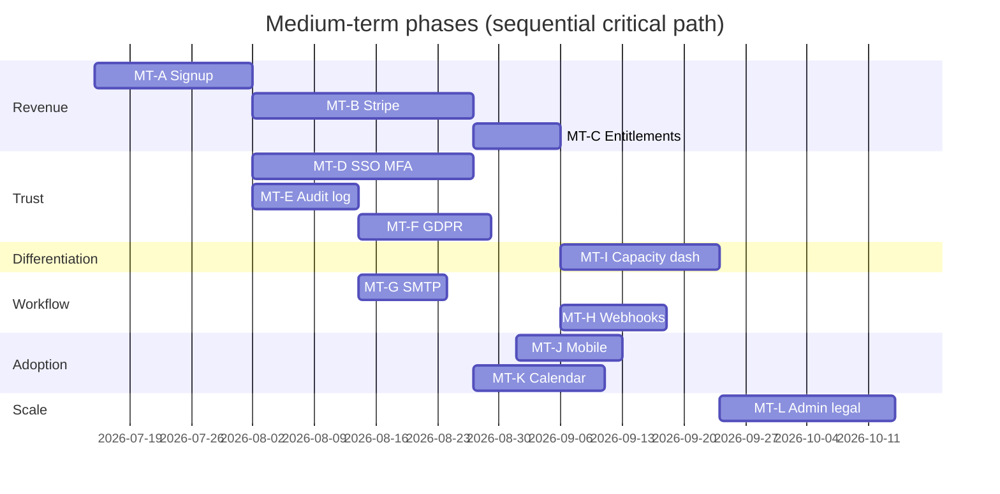

# ERM — Medium-Term Implementation Plan (3–9 months)

**Source:** [PRODUCT_AUDIT_INTERNATIONAL_SAAS.md](./PRODUCT_AUDIT_INTERNATIONAL_SAAS.md) § Medium term  
**Goal:** **Sellable SaaS** — commercial model, enterprise identity, EU readiness, differentiation wedge  
**Duration:** ~20–28 weeks (1 developer) / ~12–16 weeks (2 developers)  
**Prerequisite:** Short-term sprint (ST-A–ST-H) merged and QA’d — see [SHORT_TERM_IMPLEMENTATION_PLAN.md](./SHORT_TERM_IMPLEMENTATION_PLAN.md)

**Positioning wedge (recommended):** *Resource-aware HR for project organizations* — capacity/utilization + leave impact on delivery (Option A in product audit).

---

## Overview

| Phase | Focus | Duration | Priority | Status |
|-------|--------|----------|----------|--------|
| MT-A | Self-serve signup & org provisioning | 2–3 weeks | P0 | ✅ Code complete · QA pending |
| MT-B | Stripe billing (plans, seats, trials) | 3–4 weeks | P0 | 🟡 In progress — core + seat enforcement wired · Stripe E2E QA pending |
| MT-C | Plan entitlements & feature flags | 1–2 weeks | P1 | 🟡 In progress — core gating wired |
| MT-D | SSO/OIDC + MFA (TOTP) | 3–4 weeks | P0 | 🟡 In progress — core wired · Azure/Google QA pending |
| MT-E | Persistent audit log + admin export | 2 weeks | P0 | 🟡 In progress — core wired |
| MT-F | GDPR export & erasure | 2–3 weeks | P0 | 🟡 In progress — core wired |
| MT-G | SMTP email for workflow events | 1–2 weeks | P1 | 🟡 In progress — core wired |
| MT-H | Webhooks for key events | 2 weeks | P1 | 🟡 In progress — core wired |
| MT-I | Capacity / utilization dashboard | 2–3 weeks | P1 | 🟡 In progress — core dashboard shipped |
| MT-J | Mobile-responsive employee flows | 2 weeks | P1 | ⬜ Not started |
| MT-K | Calendar sync (Google / Outlook leave) | 2–3 weeks | P1 | ⬜ Not started |
| MT-L | Scale, admin UI, legal, white-label | 3–4 weeks | P2 | ⬜ Not started |

**Outcome:** Run **paid EU pilots** with security questionnaires that don’t fail on basics; clear differentiation vs HR-only and resourcing-only tools.

---

## Current codebase baseline (what you build on)

| Area | Today | Gap |
|------|--------|-----|
| Auth | JWT + refresh, httpOnly cookies, password reset | No signup, SSO, MFA |
| Billing UI | `billing-settings` reads API (`planName`, `amount`, `currency`) | Stripe portal/checkout when configured; seat count shown |
| Multi-tenant | `organization_id` on entities, org switcher | No self-serve tenant creation |
| Audit | `AuditLogService` → SLF4J only | No `audit_events` table or admin UI |
| Resource intel | `ResourceAllocationService`, reporting APIs | No dedicated utilization dashboard UI |
| Roles | `RoleController`, `UserRoleController` | Settings roles UI read-only / partial |
| Notifications | In-app inbox wired (ST-D) | SMTP on leave/time/task workflows when `MAIL_ENABLED` |
| i18n | EN/FR core modules | Settings/legal pages, locale formats |
| Tables | TanStack client-side (ST-C) | No server-side pagination |

---

## Phase MT-A — Self-serve signup & org provisioning

**Goal:** New customer can create an organization and first admin without manual ops.

| ID | Task | Status |
|----|------|--------|
| MT-A.1 | `POST /auth/signup` — email, password, org name, accept ToS | ✅ |
| MT-A.2 | Flyway V16: org subscription stubs (`plan_code`, `stripe_customer_id`, `trial_ends_at`) | ✅ |
| MT-A.3 | Signup wizard (3 steps): account → org → review/terms | ✅ |
| MT-A.4 | Email verification token | ⬜ Deferred |
| MT-A.5 | `erm.signup.enabled` flag + rate limit on `/auth/signup` | ✅ |
| MT-A.6 | Integration tests: signup → session | ✅ |

**Key files:** `OrganizationProvisioningService`, `SignupRequestDTO`, `features/auth/signup/`, `V16__organization_subscription_fields.sql`.

**Acceptance criteria**

- [x] New org + `ORG_ADMIN` user created in one flow
- [x] User lands in dashboard with session cookies
- [x] Duplicate email returns 409
- [ ] Manual QA on staging

---

## Phase MT-B — Stripe billing

**Goal:** Real subscription revenue; billing settings reflect live Stripe data.

| ID | Task | Owner | Effort | Notes |
|----|------|-------|--------|-------|
| MT-B.1 | Stripe account + products/prices (Starter, Pro, trial 14d) | Ops | 1d | Document in `docs/billing/` |
| MT-B.2 | `StripeBillingService` — customer, subscription, portal session | Backend | 3d | ✅ Webhook signature verification |
| MT-B.3 | `POST /webhooks/stripe` — `checkout.session.completed`, `invoice.paid`, `customer.subscription.updated` | Backend | 2d | ✅ Idempotent `stripe_webhook_events` |
| MT-B.4 | Replace hardcoded billing DTO with Stripe-backed `BillingSettingsResponseDTO` | Backend | 1d | ✅ `SettingsService.getBilling()` |
| MT-B.5 | Billing settings: “Manage subscription” → Stripe Customer Portal | Frontend | 2d | ✅ Portal + checkout CTAs |
| MT-B.6 | Seat count = active employees; enforce on invite/create employee | Backend | 2d | ✅ `EntitlementService.requireSeatAvailable` in `EmployeeService` |
| MT-B.7 | E2E smoke: mock Stripe webhook in CI (optional) | DevOps | 1d | ⬜ |

**Key files:** `SettingsService`, `billing-settings.component.ts`, new `StripeWebhookController`, `application.properties` `stripe.*`.

**Acceptance criteria**

- [ ] Trial → paid conversion updates `planName` in settings UI (requires Stripe test keys + webhook)
- [x] Stripe Customer Portal / checkout opens from billing page when configured
- [x] Webhook idempotency via `stripe_webhook_events`

---

## Phase MT-C — Plan entitlements & feature flags

**Goal:** Monetize tiers; gate premium features without code forks.

| ID | Task | Owner | Effort | Notes |
|----|------|-------|--------|-------|
| MT-C.1 | `PlanEntitlement` enum + `organization.plan_code` → feature map | Backend | 1d | ✅ `REPORTING`, `WEBHOOKS` |
| MT-C.2 | `EntitlementChecker` used in services + `@PreAuthorize` helpers | Backend | 1d | ✅ `EntitlementService` + 403 `UPGRADE_REQUIRED` |
| MT-C.3 | Expose entitlements on `/api/v1/ui-config` or settings | Backend | 0.5d | ✅ `GET /api/settings/entitlements` |
| MT-C.4 | Upgrade prompts in UI (billing CTA) | Frontend | 1d | ✅ Sidebar hide + reports upgrade banner |

**Acceptance criteria**

- [x] Trial org cannot access advanced report APIs (`UPGRADE_REQUIRED`)
- [x] Seat limit blocks employee create with actionable error (`SEAT_LIMIT_REACHED`)
- [ ] WEBHOOKS gating verified when MT-H ships

---

## Phase MT-D — SSO/OIDC + MFA (TOTP)

**Goal:** Pass enterprise security questionnaires for mid-market EU deals.

| ID | Task | Status |
|----|------|--------|
| MT-D.1 | Spring Security OAuth2 Client — Azure AD + Google | ✅ Conditional `OAuth2ClientConfig` + `erm.oauth2.enabled` |
| MT-D.2 | OIDC login callback → link or create user in org | ✅ `OidcLoginSuccessHandler` + `SsoAuthService` JIT |
| MT-D.3 | TOTP MFA enrollment + verify on login | ✅ `MfaService`, `V22__sso_mfa_schema.sql`, `/auth/mfa/verify` |
| MT-D.4 | Org settings: “Require MFA for all users” toggle | ✅ `/settings/security` |
| MT-D.5 | Login page: “Continue with Microsoft / Google” | ✅ Email-based provider discovery |
| MT-D.6 | Backup codes + MFA recovery flow | ✅ 8 backup codes on enroll + regenerate |

**Key files:** `SecurityConfig`, `OidcLoginSuccessHandler`, `MfaService`, `SsoAuthService`, `features/auth/login/`, `features/auth/mfa-verify/`, `features/settings/security-settings/`.

**Acceptance criteria**

- [ ] Azure AD test tenant login works end-to-end (set `OAUTH2_ENABLED=true` + client IDs)
- [ ] MFA required org blocks login until TOTP verified
- [x] Password login still works for non-SSO orgs

---

## Phase MT-E — Persistent audit log + admin export

**Goal:** Queryable audit trail for compliance and admin trust.

| ID | Task | Owner | Effort | Notes |
|----|------|-------|--------|-------|
| MT-E.1 | Flyway `V18__audit_events.sql` | Backend | 0.5d | ✅ |
| MT-E.2 | `AuditEventRepository` + persist from `AuditLogService` | Backend | 1d | ✅ Keep SLF4J mirror |
| MT-E.3 | `GET /api/v1/organizations/{id}/audit-events` paginated + filters | Backend | 1d | ✅ ORG_ADMIN only |
| MT-E.4 | `GET .../audit-events/export` CSV | Backend | 0.5d | ✅ |
| MT-E.5 | Settings → Audit log viewer | Frontend | 2d | ✅ `/settings/audit` |

**Key files:** `AuditLogService.java` (today logs only), `ARCHITECTURAL_REVIEW.md` § audit persistence.

**Acceptance criteria**

- [ ] Employee create/update appears in audit UI within 5s
- [ ] CSV export downloads with correct columns

---

## Phase MT-F — GDPR export & erasure

**Goal:** EU sales can answer “how do we export/delete personal data?”

| ID | Task | Owner | Effort | Notes |
|----|------|-------|--------|-------|
| MT-F.1 | `POST /api/v1/users/me/data-export` — async job, ZIP (JSON) | Backend | 2d | User, employee, time, leave, notifications |
| MT-F.2 | `POST /api/v1/users/me/erasure-request` — admin approval workflow | Backend | 2d | Soft-delete + anonymize PII |
| MT-F.3 | Admin: process erasure for employee offboarding | Backend | 1d | Cascade rules documented |
| MT-F.4 | Settings → Privacy: export my data, request deletion | Frontend | 1d | |
| MT-F.5 | Audit log entries for export/erasure | Backend | 0.5d | MT-E dependency |

**Implementation notes (2026-06-29)**

- `POST /api/v1/users/me/data-export` — sync ZIP (JSON + README)
- `POST /api/v1/users/me/erasure-request` — pending admin approval workflow
- `GET/POST .../organizations/{id}/privacy/...` — ORG_ADMIN approve/reject; HR/ORG admin direct offboarding erasure
- Anonymizes email/name, revokes tokens; blocks last ORG_ADMIN erasure
- Settings → Privacy UI at `/settings/privacy`

**Acceptance criteria**

- [x] User receives downloadable export (sync MVP)
- [x] Erasure anonymizes email/name; retains legal billing records per policy

---

## Phase MT-G — SMTP email notifications

**Goal:** Approvers and employees get email when in-app notification fires.

| ID | Task | Owner | Effort | Notes |
|----|------|-------|--------|-------|
| MT-G.1 | `spring.mail.*` + `EmailNotificationService` | Backend | 1d | HTML templates EN/FR |
| MT-G.2 | Send on leave/time approve/reject if `emailEnabled` | Backend | 1d | Reuse ST-D producers |
| MT-G.3 | Org-level SMTP override (optional P2) | Backend | 1d | Defer to MT-L if needed |

**Implementation notes (2026-06-29)**

- `erm.mail.*` config + `MailConfig` (conditional on `MAIL_ENABLED=true`)
- `EmailNotificationService` sends HTML email respecting `UserNotificationPreferences.emailEnabled`
- `NotificationService.notifyUser()` delivers in-app + email; wired from leave/time/task workflows
- EN HTML template in service; FR i18n deferred

**Acceptance criteria**

- [x] Approve leave → assignee gets email + in-app notification (when mail enabled)
- [x] User can disable email in notification preferences (ST-B)

---

## Phase MT-H — Webhooks

**Goal:** Integration ecosystem start; partners can react to events.

| ID | Task | Owner | Effort | Notes |
|----|------|-------|--------|-------|
| MT-H.1 | `webhook_endpoints` + `webhook_deliveries` tables | Backend | 1d | |
| MT-H.2 | CRUD admin API for webhook URLs + secret | Backend | 1d | HMAC-SHA256 signature |
| MT-H.3 | Dispatch on: `leave.approved`, `timeentry.submitted`, `employee.created` | Backend | 1d | Async queue (DB outbox MVP) |
| MT-H.4 | Settings → Webhooks UI | Frontend | 2d | Pro entitlement (MT-C) |
| MT-H.5 | Retry + delivery log viewer | Backend | 1d | |

**Implementation notes (2026-06-29)**

- `V20__webhook_endpoints.sql` — endpoints + delivery outbox
- CRUD at `/api/v1/organizations/{id}/webhooks` (ORG_ADMIN + `WEBHOOKS` entitlement)
- HMAC-SHA256 via `X-ERM-Signature` + `X-ERM-Timestamp`
- Dispatch on `leave.approved`, `timeentry.submitted`, `employee.created`
- Scheduler retries with backoff (1m → 5m → 15m → 1h → 4h)
- Settings → Webhooks UI with delivery log

**Acceptance criteria**

- [x] Test webhook receives signed POST on leave approval (when Pro + endpoint configured)
- [x] Failed delivery retried with backoff

---

## Phase MT-I — Capacity / utilization dashboard (wedge)

**Goal:** Differentiation — “who’s available, overloaded, on leave” in one view.

| ID | Task | Owner | Effort | Notes |
|----|------|-------|--------|-------|
| MT-I.1 | Promote `ResourceAllocationService` to dedicated reporting endpoint | Backend | 1d | ✅ `GET /reports/capacity` |
| MT-I.2 | New route `/reporting/capacity` — heatmap or bar chart by employee | Frontend | 3d | ✅ `/reports/capacity` + Chart.js |
| MT-I.3 | Leave overlay on capacity (who’s out this week) | Full stack | 2d | ✅ Leave days + summary per row |
| MT-I.4 | Alerts: overallocated / bench widgets on dashboard | Frontend | 1d | ✅ Home dashboard capacity widgets |
| MT-I.5 | i18n EN/FR for capacity module | Frontend | 0.5d | ✅ |

**Key files:** `ResourceAllocationService.java`, `resource-allocation.service.ts`, `reporting-dashboard/`.

**Acceptance criteria**

- [x] PM sees utilization % per employee for selected week
- [x] Leave conflicts visible on capacity view
- [ ] Manual QA on staging with real time/leave data

---

## Phase MT-J — Mobile-responsive employee flows

**Goal:** Employees submit time and leave from phone.

| ID | Task | Owner | Effort | Notes |
|----|------|-------|--------|-------|
| MT-J.1 | Audit touch targets, form layouts on `<768px` | Frontend | 1d | |
| MT-J.2 | Refactor leave request form + time entry form for mobile | Frontend | 3d | Bottom actions, single column |
| MT-J.3 | Sidebar → drawer; simplify employee nav | Frontend | 2d | `sidebar.service.ts` |
| MT-J.4 | PWA manifest + install prompt (optional) | Frontend | 1d | Foundation for long-term native |

**Acceptance criteria**

- [ ] Leave request completable on 375px viewport without horizontal scroll
- [ ] Lighthouse mobile usability ≥ 90 on key flows

---

## Phase MT-K — Calendar sync (leave)

**Goal:** HR table stakes — approved leave on Google/Outlook calendar.

| ID | Task | Owner | Effort | Notes |
|----|------|-------|--------|-------|
| MT-K.1 | OAuth for Google Calendar + Microsoft Graph | Backend | 2d | Per-user or org-wide |
| MT-K.2 | Create/update/delete calendar event on leave approval/cancel | Backend | 2d | |
| MT-K.3 | Settings → Integrations → Connect calendar | Frontend | 1d | |
| MT-K.4 | Document scopes + privacy in DPA | Docs | 0.5d | MT-L |

**Acceptance criteria**

- [ ] Approved leave appears as all-day event in connected calendar
- [ ] Cancelled leave removes event

---

## Phase MT-L — Scale, admin, legal, white-label (P2)

**Goal:** Admin self-service, legal sales support, partner path.

| ID | Task | Owner | Effort | Notes |
|----|------|-------|--------|-------|
| MT-L.1 | Role management UI wired to `RoleController` | Frontend | 2d | `roles-settings.component.ts` |
| MT-L.2 | Server-side pagination API + TanStack `manualPagination` | Full stack | 1w | Employees, projects first |
| MT-L.3 | Static pages: Privacy Policy, ToS, Cookie consent banner | Frontend + Docs | 2d | Link from signup |
| MT-L.4 | DPA template PDF in `docs/legal/` | Docs | 1d | |
| MT-L.5 | Org branding: `logo_url`, `primary_color` on `organizations` | Full stack | 2d | Apply in sidebar/login |
| MT-L.6 | Status page + public uptime (Stretch) | DevOps | 2d | |

---

## Recommended execution order

**Sprint-style sequencing (2-week sprints):**

| Sprint | Phases | Theme |
|--------|--------|-------|
| 1–2 | MT-A | Acquisition funnel |
| 3–4 | MT-B + MT-C | Revenue |
| 5–6 | MT-D | Enterprise identity |
| 7 | MT-E + MT-G | Trust + workflow email |
| 8 | MT-F | GDPR |
| 9–10 | MT-I | **Wedge feature** |
| 11 | MT-H + MT-J | Integrations + mobile |
| 12 | MT-K + MT-L | Calendar + polish |

MT-D and MT-E can run in parallel after MT-A if two developers are available.

---

## Dependencies & risks

| Risk | Mitigation |
|------|------------|
| Stripe webhook complexity | Use Stripe CLI locally; idempotency keys from day one |
| SSO tenant config sprawl | Start with 2 providers; org-level `sso_enabled` flag |
| GDPR erasure vs billing law | Legal review of retention policy before MT-F ship |
| Capacity metrics wrong | Align with `ResourceAllocationService` tests; document formula |
| Scope creep (SAML, payroll) | Explicitly out of scope — see long term in product audit |

---

## Out of scope (long term — 9–24 months)

SOC 2 Type II, multi-region data residency, SCIM, full leave accrual engine, AI staffing copilot, integration marketplace, native mobile apps — see [PRODUCT_AUDIT_INTERNATIONAL_SAAS.md](./PRODUCT_AUDIT_INTERNATIONAL_SAAS.md) § Long term.

---

## KPIs (medium-term exit)

| Metric | Target at MT complete |
|--------|------------------------|
| Paying tenants (pilot) | 5–10 |
| Signup → activated org | < 10 min self-serve |
| Enterprise security questionnaire | Pass core identity + audit + GDPR sections |
| Capacity dashboard adoption | ≥ 60% of PM-role users weekly |
| Mobile leave/time submission | ≥ 40% from mobile sessions |

---

## Related docs

| Document | Purpose |
|----------|---------|
| [SHORT_TERM_IMPLEMENTATION_PLAN.md](./SHORT_TERM_IMPLEMENTATION_PLAN.md) | Prerequisite sprint (ST-A–ST-H) |
| [PRODUCT_AUDIT_INTERNATIONAL_SAAS.md](./PRODUCT_AUDIT_INTERNATIONAL_SAAS.md) | Product strategy & competitive positioning |
| [IMPLEMENTATION_PLAN.md](./IMPLEMENTATION_PLAN.md) | Engineering/infra phases (CI, perf, observability) |
| [../backend/docs/ROLES_AND_PERMISSIONS.md](../backend/docs/ROLES_AND_PERMISSIONS.md) | RBAC for entitlements & audit access |

---

## Next action

**Option A (pilot-ready QA)** — see [PILOT_QA_CHECKLIST.md](./PILOT_QA_CHECKLIST.md)

1. **Automated gates** — `./mvnw test`, frontend prod build, Playwright smoke, Docker healthy.  
2. **Manual QA** — work through ST + MT sections in pilot checklist on `localhost:4200`.  
3. **Fix blockers** — log in pilot checklist § Blockers.  
4. **Tag baseline** — `pilot-v0.1` after sign-off and commit.

Legacy kickoff (if QA blocked on signup only):

1. Merge short-term PR and close ST QA checklist.  
2. Pick beachhead pricing (Starter vs Pro limits for MT-C).  
