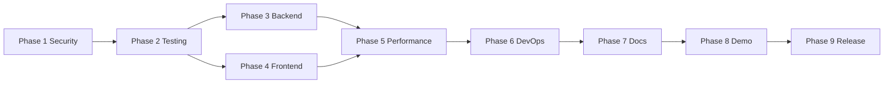

# ERM Platform — Portfolio v1.0 Implementation Roadmap

**Source:** [PORTFOLIO_AUDIT.md](./PORTFOLIO_AUDIT.md) (2026-07-05)  
**Objective:** Transform this repository into an international-level GitHub portfolio project that confidently represents a Full Stack Developer with 3+ years of professional experience.  
**Target release:** `v1.0.0` (public GitHub + portfolio showcase)  
**Estimated duration:** 4–6 weeks (1 developer, full-time) · 6–8 weeks (part-time)

---

## How to use this document

1. Complete phases **in order** unless noted as parallel-safe.
2. Each checkbox is **one PR-sized task** (or a clearly scoped sub-PR).
3. Do **not** add new product features until Phase 9 polish items are complete.
4. After each phase, run the phase **Definition of Done** checklist before proceeding.

### Dependency graph (high level)



---

# Phase 1 — Security & Multi-Tenant Authorization

## Goal

Eliminate all **critical** security defects before any public exposure. Multi-tenant isolation is the foundation of this ERP; every other improvement is meaningless if a user can access another organization's data. This phase also closes high-severity auth/crypto gaps that would fail a senior engineer's code review in the first 20 minutes.

## Tasks

### Task 1.1 — Design org-scoped authorization model

| Field | Value |
|-------|-------|
| **Priority** | 🔴 Critical |
| **Effort** | M |
| **Risk** | High (touches all secured endpoints) |
| **Dependencies** | None |

**Description**  
Document and implement a single authorization strategy. Recommended approach: **custom `PermissionEvaluator`** + **`OrganizationSecurityService`** that validates (1) user is a member of `{organizationId}`, (2) user has required role **in that org**, (3) JWT active-org claim matches path org when applicable.

**Files likely affected**

- `backend/src/main/java/com/company/erm/security/PermissionChecker.java`
- New: `OrganizationPermissionEvaluator.java`, `OrganizationSecurityService.java`
- `backend/src/main/java/com/company/erm/security/SecurityConfig.java`
- `backend/docs/architecture/` (new ADR)

**Implementation approach**

1. Write ADR: `docs/ADR-org-scoped-authorization.md`.
2. Add `requireOrgMembership(UUID orgId)` and `requireOrgRole(UUID orgId, RoleCode...)` to a single service.
3. Register `PermissionEvaluator` with `@PreAuthorize("@organizationSecurity.hasOrgAccess(#organizationId)")` pattern.
4. Deprecate global `hasRole('ORG_ADMIN')` on org-scoped controllers.

**Acceptance criteria**

- [ ] ADR approved and linked from security docs
- [ ] One canonical API for org-scoped checks (no ad-hoc patterns)
- [ ] All controllers using `{organizationId}` documented in a coverage matrix

---

### Task 1.2 — Refactor `CustomUserDetailsService` for org-neutral authorities

| Field | Value |
|-------|-------|
| **Priority** | 🔴 Critical |
| **Effort** | L |
| **Risk** | High |
| **Dependencies** | Task 1.1 |

**Description**  
Stop loading all org roles into global Spring authorities. Load only `ROLE_AUTHENTICATED` (or user identity) in the filter chain; resolve org-specific roles at evaluation time via `OrganizationSecurityService`.

**Files likely affected**

- `backend/src/main/java/com/company/erm/security/CustomUserDetailsService.java`
- `backend/src/main/java/com/company/erm/security/JwtAuthenticationFilter.java`
- `backend/src/main/java/com/company/erm/repository/UserRoleRepository.java`

**Implementation approach**

1. Change `loadUserById` to return identity-only authorities.
2. Cache org-role lookups per request (request-scoped bean or `SecurityContext` attribute).
3. Update all `@PreAuthorize` expressions to use org-scoped evaluator.

**Acceptance criteria**

- [ ] User with `ORG_ADMIN` in org A cannot pass `@PreAuthorize` for org B
- [ ] No regression on login / refresh / MFA flows

---

### Task 1.3 — Validate JWT `organizationId` claim against request context

| Field | Value |
|-------|-------|
| **Priority** | 🔴 Critical |
| **Effort** | M |
| **Risk** | Medium |
| **Dependencies** | Task 1.1 |

**Description**  
Enforce that the active organization in the JWT matches `{organizationId}` path variable (or explicit org-switch flow). Reject mismatches with 403.

**Files likely affected**

- `backend/src/main/java/com/company/erm/security/JwtTokenProvider.java`
- `backend/src/main/java/com/company/erm/security/JwtAuthenticationFilter.java`
- New: `OrganizationContextFilter.java` or extend existing filter
- `backend/src/main/java/com/company/erm/service/OrganizationSwitcherService.java`

**Implementation approach**

1. Extract `organizationId` from JWT in filter.
2. For `/api/v1/organizations/{organizationId}/**`, compare path UUID to claim.
3. Allow org-switch endpoint to issue new token; invalidate mismatch elsewhere.

**Acceptance criteria**

- [ ] Request to org B with token for org A returns 403
- [ ] Org switch updates claim and subsequent requests succeed

---

### Task 1.4 — Fix `SearchService` and reporting authorization gaps

| Field | Value |
|-------|-------|
| **Priority** | 🔴 Critical |
| **Effort** | M |
| **Risk** | Medium |
| **Dependencies** | Task 1.1, 1.2 |

**Description**  
Add org membership + role checks to `SearchService`, `TimeReportService`, `LeaveReportService`, `ResourceAllocationService`, and any service accepting `organizationId` without `PermissionChecker`.

**Files likely affected**

- `backend/src/main/java/com/company/erm/service/SearchService.java`
- `backend/src/main/java/com/company/erm/controller/SearchController.java`
- `backend/src/main/java/com/company/erm/service/reporting/*.java`
- `backend/src/main/java/com/company/erm/controller/ReportingController.java`

**Implementation approach**

1. Audit all methods with `UUID organizationId` parameter (grep-driven inventory).
2. Add `organizationSecurity.requireOrgAccess(organizationId)` as first line in each.
3. Align controller `@PreAuthorize` with service-layer checks (defense in depth).

**Acceptance criteria**

- [ ] Cross-tenant search returns 403 (not 200 with empty data)
- [ ] Reporting endpoints deny cross-org access

---

### Task 1.5 — Migrate MFA secret storage to AES-GCM

| Field | Value |
|-------|-------|
| **Priority** | 🔴 Critical |
| **Effort** | L |
| **Risk** | Medium (data migration) |
| **Dependencies** | None |

**Description**  
Replace XOR obfuscation in `MfaPendingTokenService` / `MfaService` with `SecretEncryptionService` (AES-GCM). Introduce dedicated `ERM_ENCRYPTION_KEY` separate from `JWT_SECRET`.

**Files likely affected**

- `backend/src/main/java/com/company/erm/service/MfaService.java`
- `backend/src/main/java/com/company/erm/service/MfaPendingTokenService.java`
- `backend/src/main/java/com/company/erm/security/SecretEncryptionService.java`
- `backend/src/main/resources/application.properties`
- `backend/env.example`, `docker/env.example`
- Flyway: `V23__mfa_secret_reencrypt.sql` (if persisted secrets need migration)

**Implementation approach**

1. Add `erm.encryption.key` property with validation.
2. Use `SecretEncryptionService` for all MFA secret at-rest operations.
3. Migrate existing rows on startup or via migration script.
4. Remove XOR code and misleading comments.

**Acceptance criteria**

- [ ] No XOR/obfuscation code remains
- [ ] MFA enroll + verify works with new encryption
- [ ] Encryption key documented in `RUNBOOK.md`

---

### Task 1.6 — Replace in-memory MFA pending tokens with signed JWT

| Field | Value |
|-------|-------|
| **Priority** | 🟠 High |
| **Effort** | L |
| **Risk** | Medium |
| **Dependencies** | Task 1.5 |

**Description**  
Use existing `MfaTokenProvider` (or equivalent) for short-lived MFA pending tokens instead of `ConcurrentHashMap`. Enables horizontal scaling and removes dead code inconsistency.

**Files likely affected**

- `backend/src/main/java/com/company/erm/security/MfaTokenProvider.java`
- `backend/src/main/java/com/company/erm/service/MfaPendingTokenService.java`
- `backend/src/main/java/com/company/erm/service/AuthService.java`

**Implementation approach**

1. Issue signed JWT on login when MFA required; validate on `/auth/mfa/verify`.
2. Delete in-memory map implementation.
3. Set TTL ≤ 5 minutes.

**Acceptance criteria**

- [ ] MFA flow works across server restart
- [ ] Expired pending token returns 401 with clear error code

---

### Task 1.7 — Harden demo data and credentials

| Field | Value |
|-------|-------|
| **Priority** | 🔴 Critical |
| **Effort** | S |
| **Risk** | Low |
| **Dependencies** | None |

**Description**  
Ensure production cannot load known demo credentials (`admin@demo.com` / `password123`). Verify `erm.demo-data.enabled=false` in prod profile and `DemoDataCleanupRunner` executes.

**Files likely affected**

- `backend/src/main/resources/application-prod.properties`
- `backend/src/main/resources/db/demo-migration/V3__seed_test_data.sql`
- `backend/src/main/resources/db/migration/V11__fix_admin_password.sql`
- `docker/env.example`
- `backend/src/main/java/com/company/erm/config/DemoDataCleanupRunner.java`

**Implementation approach**

1. Add integration test: prod profile → demo user absent.
2. Move password hash comment out of versioned core migration if possible.
3. Document demo-only credentials in README with prominent warning.

**Acceptance criteria**

- [ ] `SPRING_PROFILES_ACTIVE=prod` + `ERM_DEMO_DATA_ENABLED=false` → no demo admin
- [ ] CI prod-smoke test confirms

---

### Task 1.8 — Remove password reset token from logs

| Field | Value |
|-------|-------|
| **Priority** | 🟠 High |
| **Effort** | XS |
| **Risk** | Low |
| **Dependencies** | None |

**Description**  
Remove plaintext reset token from `PasswordResetService` logs. Log event metadata only (user id, timestamp).

**Files likely affected**

- `backend/src/main/java/com/company/erm/service/PasswordResetService.java`

**Acceptance criteria**

- [ ] Grep for `rawToken` in log statements returns zero in production paths

---

### Task 1.9 — Document and implement CSRF strategy for cookie auth

| Field | Value |
|-------|-------|
| **Priority** | 🟠 High |
| **Effort** | L |
| **Risk** | Medium |
| **Dependencies** | Task 1.1 |

**Description**  
Choose and implement CSRF mitigation: either Spring CSRF with cookie-to-header pattern for SPA, or `SameSite=Strict` on access cookie + documented threat model. Update ADR.

**Files likely affected**

- `backend/src/main/java/com/company/erm/security/SecurityConfig.java`
- `backend/src/main/java/com/company/erm/security/AuthCookieService.java`
- `frontend/src/app/core/interceptors/auth.interceptor.ts`
- `docs/ADR-auth-session.md`

**Acceptance criteria**

- [ ] CSRF approach documented in ADR
- [ ] SPA requests succeed with mitigation enabled
- [ ] Security test plan updated

---

### Task 1.10 — Add nginx security headers

| Field | Value |
|-------|-------|
| **Priority** | 🟠 High |
| **Effort** | S |
| **Risk** | Low |
| **Dependencies** | None |

**Description**  
Add `Content-Security-Policy`, `X-Frame-Options`, `X-Content-Type-Options`, `Referrer-Policy`, and `Strict-Transport-Security` (TLS compose only).

**Files likely affected**

- `frontend/docker/nginx.conf`
- `frontend/docker/proxy-params.conf`
- `docker/docker-compose.tls.yml`

**Acceptance criteria**

- [ ] `curl -I` on frontend shows security headers
- [ ] App functions with CSP (no broken inline scripts)

---

### Task 1.11 — Expand rate limiting to auth-sensitive endpoints

| Field | Value |
|-------|-------|
| **Priority** | 🟡 Medium |
| **Effort** | M |
| **Risk** | Low |
| **Dependencies** | None |

**Description**  
Extend `LoginRateLimitFilter` to cover `/auth/forgot-password`, `/auth/mfa/verify`, `/auth/refresh`. Make limits configurable via properties.

**Files likely affected**

- `backend/src/main/java/com/company/erm/security/LoginRateLimitFilter.java`
- `backend/src/main/resources/application.properties`

**Acceptance criteria**

- [ ] Brute-force on MFA verify throttled
- [ ] Limits documented in `RUNBOOK.md`

---

## Implementation Order

1. Task 1.1 (design) → 1.2 → 1.3 → 1.4 (authorization chain)
2. Task 1.5 → 1.6 (MFA crypto path, parallel to 1.2–1.4 after 1.1)
3. Task 1.7, 1.8 (quick wins, anytime in phase)
4. Task 1.9 (after 1.1)
5. Task 1.10, 1.11 (parallel-safe)

## Verification

| Area | How to verify |
|------|----------------|
| Cross-tenant access | Integration test: user in org A calls org B endpoints → 403 |
| JWT org claim | Test token org mismatch → 403 |
| MFA encryption | Unit test round-trip encrypt/decrypt; manual enroll flow |
| Demo data | Prod profile integration test |
| CSRF | Manual: cross-origin POST without token fails |
| Headers | `curl -I` + securityheaders.com scan on staging |
| Rate limits | Automated test: 11th login attempt in 1 min → 429 |

**Regression checks:** Full auth flow (login, refresh, logout, MFA, org switch), employee CRUD smoke test.

## Deliverables

- ADR: org-scoped authorization
- Updated `PermissionEvaluator` / `OrganizationSecurityService`
- MFA secrets encrypted with AES-GCM
- Security headers in nginx
- Cross-tenant denial tests (initial set)
- Updated `SECURITY_TEST_PLAN.md`

## Definition of Done

- [x] Zero 🔴 Critical security items remain open
- [x] Cross-tenant integration tests pass
- [x] No known demo credentials in prod configuration
- [x] CSRF strategy documented and implemented
- [x] Security phase reviewed by second engineer (or self-review checklist completed)

### Phase 1 checklist

- [x] Task 1.1 — Design org-scoped authorization model
- [x] Task 1.2 — Refactor `CustomUserDetailsService`
- [x] Task 1.3 — Validate JWT `organizationId` claim
- [x] Task 1.4 — Fix SearchService and reporting authorization
- [x] Task 1.5 — MFA AES-GCM encryption
- [x] Task 1.6 — JWT-based MFA pending tokens
- [x] Task 1.7 — Harden demo data and credentials
- [x] Task 1.8 — Remove password reset token from logs
- [x] Task 1.9 — CSRF strategy for cookie auth
- [x] Task 1.10 — nginx security headers
- [x] Task 1.11 — Expand rate limiting

---

# Phase 2 — Testing Foundation & CI Quality Gates

## Goal

Establish a **trustworthy regression safety net** immediately after security fixes. Testing proves Phase 1 works and prevents backsliding. CI must fail on real regressions, not pass with silent gaps.

## Tasks

### Task 2.1 — Fix stale frontend auth tests

| Field | Value |
|-------|-------|
| **Priority** | 🔴 Critical |
| **Effort** | S |
| **Risk** | Low |
| **Dependencies** | Phase 1 complete |

**Description**  
Update `auth.service.spec.ts` for cookie-based auth (`LoginResponse`, MFA branch, no `accessToken` in body).

**Files likely affected**

- `frontend/src/app/core/services/auth.service.spec.ts`
- `frontend/src/app/core/models/auth.model.ts`

**Acceptance criteria**

- [ ] `npm test` passes
- [ ] Tests cover MFA-required login response

---

### Task 2.2 — Add cross-tenant security integration test suite

| Field | Value |
|-------|-------|
| **Priority** | 🔴 Critical |
| **Effort** | L |
| **Risk** | Low |
| **Dependencies** | Phase 1 |

**Description**  
Create `CrossTenantSecurityIntegrationTest` covering search, reporting, employees, projects, time entries, leave requests.

**Files likely affected**

- New: `backend/src/test/java/com/company/erm/security/CrossTenantSecurityIntegrationTest.java`
- `backend/src/test/java/com/company/erm/config/TestDataFactory.java`

**Acceptance criteria**

- [ ] ≥ 10 cross-tenant denial scenarios
- [ ] Tests run in CI

---

### Task 2.3 — Add backend integration tests for untested domains

| Field | Value |
|-------|-------|
| **Priority** | 🟠 High |
| **Effort** | XXL |
| **Risk** | Low |
| **Dependencies** | Task 2.2 |

**Description**  
Add controller integration tests for: time entries, leave requests, tasks, settings security, MFA, webhooks (minimum happy path + 403).

**Files likely affected**

- New: `*ControllerIntegrationTest.java` (5–7 files)
- `backend/src/test/java/com/company/erm/config/MockMvcTestConfiguration.java`

**Acceptance criteria**

- [ ] ≥ 8 new integration test classes
- [ ] Each major controller has at least smoke + forbidden tests

---

### Task 2.4 — Enforce JaCoCo gate in CI

| Field | Value |
|-------|-------|
| **Priority** | 🟠 High |
| **Effort** | S |
| **Risk** | Medium (may expose coverage gap) |
| **Dependencies** | Task 2.3 (partial) |

**Description**  
Change CI from `mvnw test` to `mvnw verify`. Start with 40% line coverage floor, raise to 50% before release.

**Files likely affected**

- `.github/workflows/ci.yml`
- `backend/pom.xml`

**Acceptance criteria**

- [ ] CI fails when coverage below threshold
- [ ] Coverage report uploaded as artifact

---

### Task 2.5 — Add frontend test coverage baseline

| Field | Value |
|-------|-------|
| **Priority** | 🟠 High |
| **Effort** | XL |
| **Risk** | Low |
| **Dependencies** | Task 2.1 |

**Description**  
Add tests for: `authGuard`, `guestGuard`, `ApiService`, one list page component, one form component. Target ≥ 15 spec files.

**Files likely affected**

- `frontend/src/app/core/guards/auth.guard.spec.ts` (new)
- `frontend/src/app/core/services/api.service.spec.ts` (new)
- `frontend/src/app/features/employees/employee-list/*.spec.ts` (new)

**Acceptance criteria**

- [ ] ≥ 15 frontend spec files
- [ ] `npm test` in CI passes

---

### Task 2.6 — Expand E2E tests

| Field | Value |
|-------|-------|
| **Priority** | 🟠 High |
| **Effort** | XL |
| **Risk** | Medium (flaky tests) |
| **Dependencies** | Phase 1 |

**Description**  
Add Playwright specs: employee create, leave request flow, org switch, MFA verify (mocked), role-denied redirect.

**Files likely affected**

- `e2e/tests/login.spec.ts`
- New: `e2e/tests/employees.spec.ts`, `leave-requests.spec.ts`, `auth-mfa.spec.ts`

**Acceptance criteria**

- [ ] ≥ 5 E2E specs
- [ ] E2E runs in CI with Docker stack

---

### Task 2.7 — Add Flyway migration test against PostgreSQL

| Field | Value |
|-------|-------|
| **Priority** | 🟡 Medium |
| **Effort** | L |
| **Risk** | Medium |
| **Dependencies** | None |

**Description**  
CI job: start Postgres service, run Flyway migrate from scratch, run subset of integration tests.

**Files likely affected**

- `.github/workflows/ci.yml`
- New: `backend/src/test/java/com/company/erm/config/FlywayMigrationIntegrationTest.java`

**Acceptance criteria**

- [ ] Clean DB migrates V1–Vn without error
- [ ] Runs on every PR

---

### Task 2.8 — Fail CI on high npm audit findings

| Field | Value |
|-------|-------|
| **Priority** | 🟡 Medium |
| **Effort** | XS |
| **Risk** | Low |
| **Dependencies** | None |

**Description**  
Remove `continue-on-error: true` from npm audit step; fix or document exceptions.

**Files likely affected**

- `.github/workflows/ci.yml`

**Acceptance criteria**

- [ ] High/critical npm vulnerabilities fail CI or have documented suppression file

---

## Implementation Order

1. Task 2.1 (unblock CI) → 2.2 (security proof) → 2.3 (breadth)
2. Task 2.4 (enforce gate once tests exist)
3. Task 2.5, 2.6 (parallel)
4. Task 2.7, 2.8 (parallel)

## Verification

- `./mvnw verify` green locally and in CI
- `npm test` green
- Playwright E2E green
- Coverage report ≥ 40% backend line coverage (50% at release)
- Manual: break org check → cross-tenant test fails

## Deliverables

- Cross-tenant test suite
- 8+ new backend integration tests
- 15+ frontend specs
- 5+ E2E specs
- CI quality gates enforced

## Definition of Done

- [x] CI pipeline fails on test/coverage/lint regressions
- [x] Cross-tenant tests comprehensive and passing
- [x] No stale/broken tests in codebase
- [x] Coverage trend documented in README badge

### Phase 2 checklist

- [x] Task 2.1 — Fix stale frontend auth tests
- [x] Task 2.2 — Cross-tenant security integration tests
- [x] Task 2.3 — Backend integration tests (untested domains)
- [x] Task 2.4 — Enforce JaCoCo in CI (`mvn verify`)
- [x] Task 2.5 — Frontend test coverage baseline
- [x] Task 2.6 — Expand E2E tests
- [x] Task 2.7 — Flyway migration test (PostgreSQL)
- [x] Task 2.8 — Fail CI on npm audit high

---

# Phase 3 — Backend Quality & API Consistency

## Goal

Raise backend maintainability to production standards: consistent API contracts, pagination everywhere, proper error handling, and incremental decomposition of god services—**without** adding new features.

## Tasks

### Task 3.1 — Standardize API path variables and versioning policy

| Field | Value |
|-------|-------|
| **Priority** | 🟡 Medium |
| **Effort** | M |
| **Risk** | Medium (breaking changes) |
| **Dependencies** | Phase 1 |

**Description**  
Rename `{orgId}` → `{organizationId}` everywhere. Document versioning policy: `/api/v1` for org resources; `/api/settings` remains unversioned with note in OpenAPI.

**Files likely affected**

- `backend/src/main/java/com/company/erm/controller/ProjectController.java`
- All controllers with path variables
- `frontend/src/app/core/services/*.ts`

**Acceptance criteria**

- [ ] Consistent `{organizationId}` naming
- [ ] `docs/API_VERSIONING.md` published

---

### Task 3.2 — Add server-side pagination to list endpoints

| Field | Value |
|-------|-------|
| **Priority** | 🟠 High |
| **Effort** | XL |
| **Risk** | Medium |
| **Dependencies** | None |

**Description**  
Convert `LeaveRequestController`, `TimeEntryController`, `TaskController` list endpoints to `Page<T>` with `Pageable`.

**Files likely affected**

- `backend/src/main/java/com/company/erm/controller/LeaveRequestController.java`
- `backend/src/main/java/com/company/erm/controller/TimeEntryController.java`
- `backend/src/main/java/com/company/erm/controller/TaskController.java`
- Corresponding services and repositories
- Frontend list components and services

**Acceptance criteria**

- [ ] All list endpoints return `{ content, totalElements, totalPages }`
- [ ] Default page size 20, max 100

---

### Task 3.3 — Replace reporting `PageRequest.of(0, 10000)` with aggregations

| Field | Value |
|-------|-------|
| **Priority** | 🟠 High |
| **Effort** | XL |
| **Risk** | Medium |
| **Dependencies** | None |

**Description**  
Rewrite dashboard/reporting queries to use SQL `COUNT`/`SUM`/`GROUP BY` instead of loading all rows.

**Files likely affected**

- `backend/src/main/java/com/company/erm/service/reporting/DashboardService.java`
- `CapacityDashboardService.java`, `TimeReportService.java`, `LeaveReportService.java`, `ResourceAllocationService.java`
- Repository custom queries

**Acceptance criteria**

- [ ] No `10000` page size in reporting services
- [ ] Dashboard p95 response < 500ms on demo data (100 employees)

---

### Task 3.4 — Unify error responses and fix locale inconsistency

| Field | Value |
|-------|-------|
| **Priority** | 🟡 Medium |
| **Effort** | S |
| **Risk** | Low |
| **Dependencies** | None |

**Description**  
English-only API messages. Replace French 500 message. Use `ErrorResponse` in auth entry point.

**Files likely affected**

- `backend/src/main/java/com/company/erm/exception/GlobalExceptionHandler.java`
- `backend/src/main/java/com/company/erm/security/JwtAuthenticationEntryPoint.java` (or equivalent)

**Acceptance criteria**

- [ ] All error responses use `ErrorResponse` schema
- [ ] No French strings in API responses

---

### Task 3.5 — Add validation to update DTOs

| Field | Value |
|-------|-------|
| **Priority** | 🟡 Medium |
| **Effort** | L |
| **Risk** | Low |
| **Dependencies** | None |

**Description**  
Add `@NotBlank`, `@Size`, `@Email` to update DTOs missing constraints. Ensure `@Valid` on all controller bodies.

**Files likely affected**

- `backend/src/main/java/com/company/erm/dto/**/*.java`
- Controllers

**Acceptance criteria**

- [ ] Invalid update payload returns 400 with field details
- [ ] Validation documented in OpenAPI

---

### Task 3.6 — Add OpenAPI annotations to all controllers

| Field | Value |
|-------|-------|
| **Priority** | 🟠 High |
| **Effort** | XL |
| **Risk** | Low |
| **Dependencies** | Task 3.1 |

**Description**  
Add `@Tag`, `@Operation`, `@ApiResponse` to all controllers. Document cookie + Bearer security scheme.

**Files likely affected**

- All `backend/src/main/java/com/company/erm/controller/*.java`
- New: `backend/src/main/java/com/company/erm/config/OpenApiConfig.java`

**Acceptance criteria**

- [ ] Swagger UI lists all endpoints with descriptions
- [ ] Security scheme documented

---

### Task 3.7 — Resolve Employee vs User model

| Field | Value |
|-------|-------|
| **Priority** | 🟡 Medium |
| **Effort** | XL |
| **Risk** | High |
| **Dependencies** | Task 2.3 |

**Description**  
Choose single source of truth: either remove `Employee` entity and table usage, or properly link `User` ↔ `Employee`. Document decision in ADR.

**Files likely affected**

- `backend/src/main/java/com/company/erm/entity/Employee.java`
- `EmployeeService.java`, `EmployeeMapper.java`
- Flyway migration if schema changes

**Acceptance criteria**

- [ ] No dual-model confusion in services
- [ ] ADR documents decision

---

### Task 3.8 — Extract notification/webhook side-effects from god services

| Field | Value |
|-------|-------|
| **Priority** | 🟡 Medium |
| **Effort** | XL |
| **Risk** | Medium |
| **Dependencies** | Task 2.3 |

**Description**  
Split `TimeEntryService` and `LeaveRequestService`: extract `TimeEntryWorkflowService` or use domain events for notifications/webhooks. Target < 250 LOC per service.

**Files likely affected**

- `TimeEntryService.java`, `LeaveRequestService.java`
- New workflow/event classes

**Acceptance criteria**

- [ ] Services under 250 LOC
- [ ] Existing tests pass

---

### Task 3.9 — Fix `pom.xml` groupId and move test config

| Field | Value |
|-------|-------|
| **Priority** | 🟢 Low |
| **Effort** | S |
| **Risk** | Low |
| **Dependencies** | None |

**Description**  
Change `groupId` to `com.company.erm`. Move `TestJpaConfiguration` to `src/test/java`.

**Files likely affected**

- `backend/pom.xml`
- `backend/src/main/java/com/company/erm/config/TestJpaConfiguration.java`

**Acceptance criteria**

- [ ] `groupId` matches package namespace
- [ ] No test config in main sources

---

### Task 3.10 — Add optimistic locking to high-contention entities

| Field | Value |
|-------|-------|
| **Priority** | 🟡 Medium |
| **Effort** | L |
| **Risk** | Medium |
| **Dependencies** | Flyway migration |

**Description**  
Add `@Version` to `User`, `Project`, `TimeEntry`, `LeaveRequest`. Return 409 on conflict.

**Files likely affected**

- Entity classes
- `V23__add_version_columns.sql` (or next available)
- `GlobalExceptionHandler.java`

**Acceptance criteria**

- [ ] Concurrent update returns 409 with clear message
- [ ] Integration test for conflict

---

## Implementation Order

1. Task 3.4, 3.9 (quick wins)
2. Task 3.1 → 3.6 (API docs chain)
3. Task 3.3 (reporting perf) — high impact
4. Task 3.2 (pagination) — coordinate with Phase 4
5. Task 3.5, 3.7, 3.8, 3.10

## Verification

- OpenAPI spec complete; Swagger UI smoke test
- Load test: dashboard with 500 employees < 1s
- Pagination: page 2 returns correct slice
- Optimistic lock: parallel PUT → one 409

## Deliverables

- Paginated list APIs
- Aggregation-based reporting
- Complete OpenAPI documentation
- Cleaner service boundaries
- `API_VERSIONING.md`

## Definition of Done

- [ ] No `PageRequest.of(0, 10000)` in codebase
- [ ] All list endpoints paginated
- [ ] OpenAPI covers 100% of controllers
- [ ] Error responses consistent and English-only

### Phase 3 checklist

- [x] Task 3.1 — Standardize API path variables and versioning
- [x] Task 3.2 — Server-side pagination on list endpoints
- [x] Task 3.3 — Reporting aggregation queries
- [x] Task 3.4 — Unify error responses (English)
- [x] Task 3.5 — Validation on update DTOs
- [x] Task 3.6 — OpenAPI annotations
- [x] Task 3.7 — Resolve Employee vs User model
- [x] Task 3.8 — Extract god service side-effects
- [x] Task 3.9 — Fix pom groupId and test config
- [x] Task 3.10 — Optimistic locking

---

# Phase 4 — Frontend Refactoring & UX Hardening

## Goal

Eliminate 30–40% code duplication, consolidate the UI kit, fix i18n properly, and improve accessibility—so the frontend matches the visual quality already achieved.

## Tasks

### Task 4.1 — Remove unused `@angular/material` dependency

| Field | Value |
|-------|-------|
| **Priority** | 🟠 High |
| **Effort** | XS |
| **Risk** | Low |
| **Dependencies** | None |

**Files likely affected:** `frontend/package.json`, `package-lock.json`

**Acceptance criteria:** `npm run build` succeeds; bundle size reduced.

---

### Task 4.2 — Consolidate dual UI libraries (Zard → ui/)

| Field | Value |
|-------|-------|
| **Priority** | 🟠 High |
| **Effort** | XXL |
| **Risk** | High |
| **Dependencies** | Task 4.1 |

**Description**  
Migrate all Zard imports to `shared/components/ui/`. Delete `button/`, `tabs/`, `popover/`, `calendar/`, `badge/` (Zard variants).

**Files likely affected**

- `frontend/src/app/shared/components/**`
- All feature components importing Zard

**Acceptance criteria**

- [ ] Zero imports from legacy Zard paths
- [ ] Legacy directories deleted

---

### Task 4.3 — Create `ListPageShell` shared component

| Field | Value |
|-------|-------|
| **Priority** | 🟠 High |
| **Effort** | XL |
| **Risk** | Medium |
| **Dependencies** | Task 4.2 |

**Description**  
Extract common list page pattern: header, error banner, skeleton, empty state, stat cards, filter tabs, content slot.

**Files likely affected**

- New: `frontend/src/app/shared/components/list-page-shell/`
- `employee-list`, `department-list`, `project-list`, `leave-request-list`, `time-entry-list`

**Acceptance criteria**

- [ ] 5 list pages use shell; duplicated HTML reduced ≥ 60%

---

### Task 4.4 — Create configurable `EntityDataTable` wrapper

| Field | Value |
|-------|-------|
| **Priority** | 🟠 High |
| **Effort** | XXL |
| **Risk** | High |
| **Dependencies** | Task 4.3 |

**Description**  
Generic TanStack table wrapper accepting column config + row actions template. Replace 5 `*-data-table.component.ts` files.

**Files likely affected**

- New: `frontend/src/app/shared/components/entity-data-table/`
- Delete or thin: `*-data-table.component.ts` (5 files)

**Acceptance criteria**

- [ ] One table abstraction; feature tables < 80 LOC each

---

### Task 4.5 — Adopt `EmptyStateComponent` everywhere

| Field | Value |
|-------|-------|
| **Priority** | 🟡 Medium |
| **Effort** | S |
| **Risk** | Low |
| **Dependencies** | Task 4.3 |

**Description**  
Fix `EmptyStateComponent` content projection; replace inlined empty states. Remove `innerHTML` for icons (use `lucide-icon`).

**Files likely affected**

- `frontend/src/app/shared/components/ui/empty-state/empty-state.component.ts`
- All list page templates

**Acceptance criteria**

- [ ] No inlined empty state markup in feature pages
- [ ] No `innerHTML` for icons

---

### Task 4.6 — Create shared `FormErrorService` / `getFieldError` utility

| Field | Value |
|-------|-------|
| **Priority** | 🟡 Medium |
| **Effort** | M |
| **Risk** | Low |
| **Dependencies** | None |

**Description**  
Single i18n-aware field error helper; remove 8× duplicated `getFieldError()`.

**Files likely affected**

- New: `frontend/src/app/shared/utils/form-errors.ts`
- All form components

**Acceptance criteria**

- [x] All forms use shared helper
- [x] Validation messages i18n-key based

---

### Task 4.7 — Unify HTTP error handling through `ApiService`

| Field | Value |
|-------|-------|
| **Priority** | 🟡 Medium |
| **Effort** | M |
| **Risk** | Low |
| **Dependencies** | None |

**Description**  
Route `AuthService` and `SecurityService` through `ApiService` or shared `extractErrorMessage()`.

**Files likely affected**

- `auth.service.ts`, `security.service.ts`, `api.service.ts`

**Acceptance criteria**

- [ ] Single error extraction path
- [ ] No duplicated `err.details[0]` blocks in components

---

### Task 4.8 — Fix i18n change detection properly

| Field | Value |
|-------|-------|
| **Priority** | 🟡 Medium |
| **Effort** | M |
| **Risk** | Medium |
| **Dependencies** | None |

**Description**  
Make `TranslatePipe` depend on `TranslationService.currentLanguage()` signal (impure pipe or computed). Remove `appRef.tick()` and `languageTick()` hacks.

**Files likely affected**

- `frontend/src/app/core/pipes/translate.pipe.ts`
- `translation.service.ts`
- `project-form.component.ts`

**Acceptance criteria**

- [ ] Language switch updates all visible text without manual tick
- [ ] No `appRef.tick()` in codebase

---

### Task 4.9 — Improve `roleGuard` UX

| Field | Value |
|-------|-------|
| **Priority** | 🟡 Medium |
| **Effort** | S |
| **Risk** | Low |
| **Dependencies** | None |

**Description**  
Show toast on role denial: "You don't have permission to access this page."

**Files likely affected**

- `frontend/src/app/core/guards/role.guard.ts`
- `frontend/src/assets/i18n/en.json`, `fr.json`

**Acceptance criteria**

- [ ] Denied access shows i18n toast before redirect

---

### Task 4.10 — Accessibility pass

| Field | Value |
|-------|-------|
| **Priority** | 🟡 Medium |
| **Effort** | L |
| **Risk** | Low |
| **Dependencies** | Task 4.3 |

**Description**  
Add skip-to-main link, `aria-live` on error banners, keyboard trap on shortcuts modal, sort labels on tables.

**Files likely affected**

- `main-layout.component.html`
- `keyboard-shortcuts.component.ts`
- Data table components

**Acceptance criteria**

- [ ] axe-core scan: zero critical violations on dashboard, employees, login

---

### Task 4.11 — Consolidate duplicate TypeScript models

| Field | Value |
|-------|-------|
| **Priority** | 🟢 Low |
| **Effort** | S |
| **Risk** | Low |
| **Dependencies** | None |

**Description**  
Single `SecuritySettings` type in `security.model.ts`; re-export from auth if needed.

**Files likely affected**

- `auth.model.ts`, `security.model.ts`

**Acceptance criteria**

- [ ] No duplicate interface definitions

---

### Task 4.12 — Wire frontend to server-side pagination

| Field | Value |
|-------|-------|
| **Priority** | 🟠 High |
| **Effort** | L |
| **Risk** | Medium |
| **Dependencies** | Task 3.2 |

**Description**  
Remove `getEmployees({ size: 1000 })` pattern. Use paginated API with TanStack server-side pagination.

**Files likely affected**

- List components and services
- Form components using employee dropdowns (use search/autocomplete instead)

**Acceptance criteria**

- [ ] No `size: 1000` in frontend codebase
- [ ] Dropdowns use async search with debounce

---

## Implementation Order

1. Task 4.1 → 4.2 (foundation)
2. Task 4.6, 4.7, 4.8, 4.11 (parallel quick wins)
3. Task 4.3 → 4.4 → 4.5 (structural refactor)
4. Task 4.12 (after backend pagination)
5. Task 4.9, 4.10 (polish)

## Verification

- `npm run build` and `npm run lint` pass
- Visual regression: all list pages render correctly
- Language switch updates forms and lists
- Lighthouse accessibility ≥ 90 on login and dashboard

## Deliverables

- Single UI component library
- `ListPageShell` + `EntityDataTable`
- Shared form error and HTTP error utilities
- Fixed i18n pipeline
- Server-side pagination wired

## Definition of Done

- [ ] No Zard imports remain
- [ ] List/table duplication reduced ≥ 60%
- [ ] No `size: 1000` fetches
- [ ] i18n works without `appRef.tick()`

### Phase 4 checklist

- [x] Task 4.1 — Remove `@angular/material`
- [x] Task 4.2 — Consolidate Zard → ui/
- [x] Task 4.3 — Create `ListPageShell`
- [x] Task 4.4 — Create `EntityDataTable`
- [x] Task 4.5 — Adopt `EmptyStateComponent`
- [ ] Task 4.6 — Shared `FormErrorService`
- [ ] Task 4.7 — Unify HTTP error handling
- [ ] Task 4.8 — Fix i18n change detection
- [ ] Task 4.9 — Improve `roleGuard` UX
- [ ] Task 4.10 — Accessibility pass
- [ ] Task 4.11 — Consolidate duplicate models
- [ ] Task 4.12 — Server-side pagination (frontend)

---

# Phase 5 — Performance & Scalability

## Goal

Ensure the application performs credibly under demo-scale load and does not embarrass you in a technical interview when someone asks "what happens with 10,000 employees?"

## Tasks

### Task 5.1 — Cache org-scoped roles per request

| Field | Value |
|-------|-------|
| **Priority** | 🟡 Medium |
| **Effort** | M |
| **Risk** | Low |
| **Dependencies** | Phase 1 |

**Description**  
Avoid repeated `UserRoleRepository` queries within a single request. Request-scoped role cache.

**Files likely affected**

- `OrganizationSecurityService.java`
- `CustomUserDetailsService.java`

**Acceptance criteria**

- [ ] ≤ 1 role DB query per request (verify with query logging)

---

### Task 5.2 — Add `@EntityGraph` / fetch joins for list endpoints

| Field | Value |
|-------|-------|
| **Priority** | 🟡 Medium |
| **Effort** | L |
| **Risk** | Medium |
| **Dependencies** | Task 3.2 |

**Description**  
Eliminate N+1 on employee list, project list (department, roles).

**Files likely affected**

- `EmployeeRepository.java`, `EmployeeMapper.java`
- `ProjectRepository.java`

**Acceptance criteria**

- [ ] Employee list: ≤ 3 queries per page (Hibernate stats)

---

### Task 5.3 — Enable `OnPush` on list and table components

| Field | Value |
|-------|-------|
| **Priority** | 🟢 Low |
| **Effort** | M |
| **Risk** | Low |
| **Dependencies** | Phase 4 |

**Description**  
Set `changeDetection: ChangeDetectionStrategy.OnPush` on list pages, data tables, dashboard.

**Acceptance criteria**

- [ ] All list/table components use OnPush
- [ ] No UI regressions

---

### Task 5.4 — Bundle analysis and budget enforcement

| Field | Value |
|-------|-------|
| **Priority** | 🟡 Medium |
| **Effort** | S |
| **Risk** | Low |
| **Dependencies** | Task 4.2 |

**Description**  
Add `ng build --stats-json`; set initial bundle budget in `angular.json` (e.g. 500kb warning, 1mb error).

**Files likely affected**

- `frontend/angular.json`
- `.github/workflows/ci.yml`

**Acceptance criteria**

- [ ] CI fails if initial bundle exceeds budget
- [ ] Bundle size noted in README

---

### Task 5.5 — Extract magic numbers to constants

| Field | Value |
|-------|-------|
| **Priority** | 🟢 Low |
| **Effort** | S |
| **Risk** | Low |
| **Dependencies** | Task 3.3 |

**Description**  
Replace `10000`, `1000`, `200` with named constants in backend and frontend.

**Acceptance criteria**

- [ ] Grep for magic pagination sizes returns only constants files

---

## Implementation Order

1. Task 5.1 → 5.2 (backend)
2. Task 5.3, 5.4, 5.5 (frontend, parallel)

## Verification

- Hibernate query count on employee list page
- Lighthouse performance ≥ 80 on dashboard
- Bundle size documented and within budget

## Deliverables

- Request-scoped role cache
- N+1 fixes on primary list endpoints
- Bundle budget in CI

## Definition of Done

- [ ] Dashboard < 500ms p95 on demo data
- [ ] No N+1 on employee/project list
- [ ] Bundle budget enforced

### Phase 5 checklist

- [ ] Task 5.1 — Cache org-scoped roles per request
- [ ] Task 5.2 — EntityGraph / fetch joins
- [ ] Task 5.3 — OnPush on list components
- [ ] Task 5.4 — Bundle analysis and budgets
- [ ] Task 5.5 — Extract magic numbers

---

# Phase 6 — DevOps, Tooling & Observability

## Goal

Professional engineering workflow: hooks, dependency automation, security scanning, and operational baselines that recruiters recognize from production teams.

## Tasks

### Task 6.1 — Add Husky + lint-staged

| Field | Value |
|-------|-------|
| **Priority** | 🟠 High |
| **Effort** | S |
| **Risk** | Low |
| **Dependencies** | None |

**Files:** `package.json` (root or frontend), `.husky/pre-commit`

**Acceptance criteria:** Pre-commit runs ESLint on staged frontend files.

---

### Task 6.2 — Add `.editorconfig`

| Field | Value |
|-------|-------|
| **Priority** | 🟢 Low |
| **Effort** | XS |
| **Risk** | None |

**Acceptance criteria:** Consistent indent/charset across IDE.

---

### Task 6.3 — Add Spotless or Checkstyle for backend

| Field | Value |
|-------|-------|
| **Priority** | 🟡 Medium |
| **Effort** | M |
| **Risk** | Low |
| **Dependencies** | None |

**Acceptance criteria:** `mvn spotless:check` in CI.

---

### Task 6.4 — Add Dependabot + CodeQL + SECURITY.md

| Field | Value |
|-------|-------|
| **Priority** | 🟠 High |
| **Effort** | S |
| **Risk** | Low |
| **Dependencies** | None |

**Files:** `.github/dependabot.yml`, `.github/workflows/codeql.yml`, `SECURITY.md`

**Acceptance criteria:** Dependabot PRs enabled; CodeQL runs weekly.

---

### Task 6.5 — Add GitHub issue and PR templates

| Field | Value |
|-------|-------|
| **Priority** | 🟡 Medium |
| **Effort** | XS |
| **Risk** | None |

**Files:** `.github/PULL_REQUEST_TEMPLATE.md`, `.github/ISSUE_TEMPLATE/`

---

### Task 6.6 — Add Prometheus + Grafana docker overlay (optional)

| Field | Value |
|-------|-------|
| **Priority** | 🟢 Low |
| **Effort** | L |
| **Risk** | Low |
| **Dependencies** | None |

**Files:** `docker/docker-compose.observability.yml`, sample dashboard JSON

---

### Task 6.7 — Document auth events in audit log

| Field | Value |
|-------|-------|
| **Priority** | 🟡 Medium |
| **Effort** | M |
| **Risk** | Low |
| **Dependencies** | Phase 1 |

**Description**  
Audit login, logout, MFA enroll, password reset, org switch.

**Files:** `AuthService.java`, `AuditLogService.java`

---

## Implementation Order

1. Task 6.1, 6.2, 6.4, 6.5 (day 1)
2. Task 6.3, 6.7
3. Task 6.6 (optional polish)

## Definition of Done

- [ ] Pre-commit hooks work
- [ ] Dependabot and CodeQL active
- [ ] `SECURITY.md` published
- [ ] PR template requires test checklist

### Phase 6 checklist

- [ ] Task 6.1 — Husky + lint-staged
- [ ] Task 6.2 — `.editorconfig`
- [ ] Task 6.3 — Backend formatting (Spotless/Checkstyle)
- [ ] Task 6.4 — Dependabot + CodeQL + SECURITY.md
- [ ] Task 6.5 — Issue and PR templates
- [ ] Task 6.6 — Prometheus + Grafana overlay (optional)
- [ ] Task 6.7 — Auth events in audit log

---

# Phase 7 — Documentation & GitHub Presence

## Goal

Make the repository **sell the work in 30 seconds** to an international recruiter who will never clone the project.

## Tasks

### Task 7.1 — Add MIT LICENSE

| Field | Value |
|-------|-------|
| **Priority** | 🔴 Critical |
| **Effort** | XS |
| **Dependencies** | None |

**Files:** `LICENSE`

---

### Task 7.2 — Rewrite README (English, portfolio-quality)

| Field | Value |
|-------|-------|
| **Priority** | 🔴 Critical |
| **Effort** | L |
| **Risk** | Low |
| **Dependencies** | Task 7.1, screenshots (7.3) |

**Description**  
Product-page README: hero screenshot, feature bullets, architecture diagram, tech stack (Angular 19, Spring Boot 4), quick start, demo credentials warning, CI badge, link to live demo.

**Files:** `README.md`

**Sections:** Overview · Features · Screenshots · Architecture · Tech Stack · Quick Start · Demo · API Docs · Testing · Deployment · License · Contributing

---

### Task 7.3 — Capture and commit screenshots

| Field | Value |
|-------|-------|
| **Priority** | 🔴 Critical |
| **Effort** | M |
| **Dependencies** | Phase 4 (UI stable) |

**Description**  
Capture 5 screenshots: dashboard (light+dark), employee list, project detail, settings/security, login. Store in `docs/images/`.

**Acceptance criteria**

- [ ] 5 PNGs committed, referenced in README
- [ ] No sensitive real data in screenshots

---

### Task 7.4 — Add CONTRIBUTING.md

| Field | Value |
|-------|-------|
| **Priority** | 🟠 High |
| **Effort** | S |
| **Dependencies** | None |

**Content:** Prerequisites, branch strategy, test commands, commit format, PR process.

---

### Task 7.5 — Consolidate documentation index

| Field | Value |
|-------|-------|
| **Priority** | 🟡 Medium |
| **Effort** | M |
| **Dependencies** | None |

**Description**  
Update `docs/README.md` as single entry point. Archive sprint summaries to `docs/archive/`. Link PORTFOLIO_AUDIT, this roadmap, RUNBOOK, ADRs.

---

### Task 7.6 — Add CI status badges to README

| Field | Value |
|-------|-------|
| **Priority** | 🟡 Medium |
| **Effort** | XS |
| **Dependencies** | Phase 2 |

---

### Task 7.7 — Write CHANGELOG.md for v1.0.0

| Field | Value |
|-------|-------|
| **Priority** | 🟡 Medium |
| **Effort** | S |
| **Dependencies** | Phase 9 |

---

## Definition of Done

- [ ] README renders as portfolio landing page
- [ ] LICENSE file present
- [ ] Screenshots in repo
- [ ] CONTRIBUTING.md linked
- [ ] No placeholder URLs or `[Votre licence ici]`

### Phase 7 checklist

- [ ] Task 7.1 — MIT LICENSE
- [ ] Task 7.2 — Rewrite README (English)
- [ ] Task 7.3 — Screenshots
- [ ] Task 7.4 — CONTRIBUTING.md
- [ ] Task 7.5 — Consolidate docs index
- [ ] Task 7.6 — CI badges
- [ ] Task 7.7 — CHANGELOG.md

---

# Phase 8 — Live Demo Deployment

## Goal

Provide a **clickable URL** for recruiters and interviewers. A live demo increases portfolio credibility more than any feature.

## Tasks

### Task 8.1 — Choose hosting and domain strategy

| Field | Value |
|-------|-------|
| **Priority** | 🔴 Critical |
| **Effort** | S |
| **Dependencies** | Phase 1, 2 |

**Options:** Fly.io, Render, Hetzner VPS + Docker Compose, Railway.

**Acceptance criteria:** Decision documented in `docs/DEPLOYMENT.md`.

---

### Task 8.2 — Create production deployment manifest

| Field | Value |
|-------|-------|
| **Priority** | 🟠 High |
| **Effort** | L |
| **Dependencies** | Task 8.1 |

**Description**  
Hardened env: `ERM_DEMO_DATA_ENABLED=true` (read-only demo), strong `JWT_SECRET`, CORS for demo domain, `auth.cookie.secure=true`.

**Files:** `docker/env.example`, new `deploy/demo/` or update `deploy/k8s/`

---

### Task 8.3 — Deploy and run smoke tests

| Field | Value |
|-------|-------|
| **Priority** | 🔴 Critical |
| **Effort** | L |
| **Dependencies** | Task 8.2 |

**Description**  
Deploy stack; run `docker/scripts/smoke-test.sh` against live URL. Add demo link to README.

**Acceptance criteria**

- [ ] HTTPS demo URL live
- [ ] Login → dashboard → employee list works
- [ ] Demo resets nightly (optional) or read-only mode

---

### Task 8.4 — Add GitHub Actions deploy workflow (staging)

| Field | Value |
|-------|-------|
| **Priority** | 🟡 Medium |
| **Effort** | L |
| **Dependencies** | Task 8.3 |

**Description**  
Manual `workflow_dispatch` deploy to staging on tag or main.

---

## Definition of Done

- [ ] Live HTTPS demo URL in README
- [ ] Smoke tests pass against production
- [ ] Demo uses non-default credentials or clearly labeled demo org

### Phase 8 checklist

- [ ] Task 8.1 — Choose hosting
- [ ] Task 8.2 — Production deployment manifest
- [ ] Task 8.3 — Deploy and smoke test
- [ ] Task 8.4 — Deploy workflow (optional)

---

# Phase 9 — Release Candidate v1.0.0

## Goal

Final validation, tag `v1.0.0`, make repository public, and confirm the project meets the portfolio bar defined in the audit.

## Tasks

### Task 9.1 — Run full regression suite

| Field | Value |
|-------|-------|
| **Priority** | 🔴 Critical |
| **Effort** | M |
| **Dependencies** | All prior phases |

**Commands:**

```bash
cd backend && ./mvnw verify
cd frontend && npm run lint && npm test && npm run build
cd e2e && npx playwright test
cd docker && docker compose -f docker-compose.yml -f docker-compose.ci.yml up --wait
./docker/scripts/smoke-test.sh
```

---

### Task 9.2 — Execute manual QA checklist

| Field | Value |
|-------|-------|
| **Priority** | 🔴 Critical |
| **Effort** | L |
| **Dependencies** | Task 9.1 |

**Files:** `docs/PILOT_QA_CHECKLIST.md`, `docs/SECURITY_TEST_PLAN.md`

---

### Task 9.3 — Re-run portfolio audit

| Field | Value |
|-------|-------|
| **Priority** | 🔴 Critical |
| **Effort** | M |
| **Dependencies** | Task 9.2 |

**Description**  
Update `PORTFOLIO_AUDIT.md` with new scores. Target: Overall ≥ 75/100.

---

### Task 9.4 — Tag v1.0.0 and create GitHub Release

| Field | Value |
|-------|-------|
| **Priority** | 🔴 Critical |
| **Effort** | S |
| **Dependencies** | Task 9.3 |

**Description**  
Tag `v1.0.0`, publish release notes from CHANGELOG, attach screenshots.

---

### Task 9.5 — Make repository public

| Field | Value |
|-------|-------|
| **Priority** | 🔴 Critical |
| **Effort** | XS |
| **Dependencies** | Release checklist complete |

---

### Task 9.6 — Update portfolio site

| Field | Value |
|-------|-------|
| **Priority** | 🟠 High |
| **Effort** | S |
| **Dependencies** | Task 9.5 |

**Description**  
Add project to personal portfolio with screenshot, tech tags, GitHub + demo links.

---

## Definition of Done

- [ ] `v1.0.0` tagged and released
- [ ] Repository public
- [ ] Updated audit score ≥ 75/100
- [ ] Portfolio site links live

### Phase 9 checklist

- [ ] Task 9.1 — Full regression suite
- [ ] Task 9.2 — Manual QA checklist
- [ ] Task 9.3 — Re-run portfolio audit
- [ ] Task 9.4 — Tag v1.0.0 release
- [ ] Task 9.5 — Make repository public
- [ ] Task 9.6 — Update portfolio site

---

# Global Roadmap

## Estimated total duration

| Phase | Duration (full-time) |
|-------|----------------------|
| Phase 1 — Security | 5–7 days |
| Phase 2 — Testing | 5–7 days |
| Phase 3 — Backend | 5–7 days |
| Phase 4 — Frontend | 7–10 days |
| Phase 5 — Performance | 2–3 days |
| Phase 6 — DevOps | 2–3 days |
| Phase 7 — Documentation | 2–3 days |
| Phase 8 — Demo deploy | 2–3 days |
| Phase 9 — Release | 1–2 days |
| **Total** | **~4–6 weeks** |

Phases 3 and 4 can overlap after Phase 2 completes (backend pagination API before frontend wiring).

## Recommended sprint structure

| Sprint | Focus | Outcome |
|--------|-------|---------|
| **Sprint 1** (week 1) | Phase 1 | Secure multi-tenant auth |
| **Sprint 2** (week 2) | Phase 2 | Tests prove security |
| **Sprint 3** (week 3) | Phase 3 + 4 start | API quality + UI consolidation begins |
| **Sprint 4** (week 4) | Phase 4 + 5 | Frontend DRY + performance |
| **Sprint 5** (week 5) | Phase 6 + 7 + 8 | DevOps, docs, live demo |
| **Sprint 6** (week 6) | Phase 9 | Release v1.0.0 |

## Recommended commit strategy

- **Conventional Commits** with scope: `feat(security):`, `fix(auth):`, `test(e2e):`, `docs(readme):`
- **One task ≈ one PR**; squash merge to keep history readable
- **No unrelated changes** in security PRs
- Update `CHANGELOG.md` incrementally under `[Unreleased]`

## Recommended pull request strategy

**PR template checklist:**

```markdown
## Summary
<!-- What and why -->

## Task ID
<!-- e.g. Phase 1 - Task 1.4 -->

## Test plan
- [ ] Unit tests added/updated
- [ ] Integration tests added/updated
- [ ] Manual verification steps listed

## Security impact
- [ ] No cross-tenant regression
- [ ] No secrets in diff
```

- Require CI green before merge
- Security PRs (Phase 1): require self-review against `SECURITY_TEST_PLAN.md`
- Frontend refactors: include before/after screenshot

## Suggested branch naming

| Pattern | Example |
|---------|---------|
| `release/v1.0.0` | Long-lived release branch |
| `feat/phase-1-org-auth` | Phase feature |
| `fix/cross-tenant-search` | Bug fix |
| `test/cross-tenant-suite` | Test-only |
| `docs/readme-portfolio` | Documentation |

## Suggested milestones

| Milestone | Target | Gate |
|-----------|--------|------|
| **M1: Security Green** | End Sprint 1 | Cross-tenant tests pass |
| **M2: CI Trusted** | End Sprint 2 | `mvn verify` + 40% coverage |
| **M3: API Complete** | Mid Sprint 3 | OpenAPI 100%, pagination done |
| **M4: Frontend DRY** | End Sprint 4 | No Zard, ListPageShell adopted |
| **M5: Demo Live** | End Sprint 5 | HTTPS URL in README |
| **M6: v1.0.0 Public** | End Sprint 6 | Release tagged, repo public |

---

# Release Checklist

Complete **every item** before running `Task 9.5 — Make repository public`.

## Security

- [ ] Org-scoped authorization on all `{organizationId}` endpoints
- [ ] JWT org claim validated against path
- [ ] Cross-tenant integration tests pass (≥ 10 scenarios)
- [ ] MFA secrets encrypted with AES-GCM
- [ ] Dedicated encryption key (not JWT secret)
- [ ] CSRF strategy documented and implemented
- [ ] nginx security headers configured
- [ ] No password reset tokens in logs
- [ ] Demo credentials gated (`ERM_DEMO_DATA_ENABLED` false in prod)
- [ ] `SECURITY.md` published
- [ ] CodeQL workflow enabled
- [ ] OWASP Dependency-Check passing
- [ ] Rate limiting on auth endpoints

## Testing

- [ ] `./mvnw verify` passes (JaCoCo ≥ 50%)
- [ ] `npm test` passes (≥ 15 spec files)
- [ ] Playwright E2E ≥ 5 specs passing
- [ ] Flyway migrations tested on PostgreSQL
- [ ] No stale/broken tests
- [ ] `SECURITY_TEST_PLAN.md` executed manually

## Documentation

- [ ] README English, portfolio-quality
- [ ] Architecture diagram in README
- [ ] OpenAPI/Swagger linked
- [ ] `CONTRIBUTING.md` present
- [ ] `CHANGELOG.md` for v1.0.0
- [ ] `docs/README.md` index updated
- [ ] ADR for org-scoped authorization
- [ ] `PORTFOLIO_AUDIT.md` re-run with score ≥ 75/100

## GitHub

- [ ] MIT `LICENSE` file
- [ ] Correct clone URL (no placeholders)
- [ ] CI status badge in README
- [ ] PR and issue templates
- [ ] Dependabot configured
- [ ] No secrets in git history (`git log -p` spot check)
- [ ] `.gitignore` covers `.env`, certs, secrets

## Screenshots

- [ ] Dashboard (light mode)
- [ ] Dashboard (dark mode)
- [ ] Employee list
- [ ] Settings / security page
- [ ] Login page
- [ ] Images in `docs/images/`, referenced from README

## README

- [ ] Feature bullet list
- [ ] Tech stack versions accurate (Angular 19, Spring Boot 4, Java 17)
- [ ] Quick start works from clean clone
- [ ] Demo credentials with warning
- [ ] Link to live demo
- [ ] Link to API docs

## License

- [ ] MIT LICENSE committed
- [ ] License section in README

## CI

- [ ] `mvn verify` (not just `test`) in CI
- [ ] JaCoCo gate enforced
- [ ] ESLint passes (`--max-warnings 5`)
- [ ] `npm audit` fails on high (or documented exceptions)
- [ ] E2E job passes with Docker stack
- [ ] Docker build workflow succeeds

## Performance

- [ ] No `PageRequest.of(0, 10000)` in codebase
- [ ] No `size: 1000` bulk fetches in frontend
- [ ] Dashboard p95 < 500ms on demo data
- [ ] Bundle budget enforced in CI
- [ ] `@angular/material` removed

## Architecture

- [ ] Single authorization model documented
- [ ] Employee/User model resolved
- [ ] API versioning policy documented
- [ ] `groupId` matches `com.company.erm`
- [ ] No test config in `src/main/java`

## Code Quality

- [ ] No dual UI libraries (Zard removed)
- [ ] `ListPageShell` + `EntityDataTable` adopted
- [ ] Shared form error helper in use
- [ ] i18n without `appRef.tick()`
- [ ] English-only API errors
- [ ] Pre-commit hooks active
- [ ] Backend formatter in CI

## Deployment

- [ ] `docker compose up` works from README instructions
- [ ] Health checks pass (`/actuator/health`, `/health`)
- [ ] Live HTTPS demo deployed
- [ ] Smoke test passes against demo URL
- [ ] `docker/env.example` documents all required vars

## Demo

- [ ] Public demo URL in README
- [ ] Demo org seeded with realistic data
- [ ] Demo account credentials documented
- [ ] Demo does not use production secrets

## Final Audit

- [ ] `PORTFOLIO_AUDIT.md` updated with post-remediation scores
- [ ] Overall score ≥ 75/100
- [ ] Verdict changed from **NOT YET** to **YES** or **YES with notes**
- [ ] All 🔴 Critical items closed
- [ ] Release review completed

---

## Post-release (v1.1+ backlog)

These audit items are **out of scope for v1.0** but fine for follow-up:

- Bulk CSV import
- Password reset email delivery
- Storybook
- Session management UI
- Distributed rate limiting (Redis)
- SAML SSO
- Full audit coverage (projects, time, leave)
- Mobile-optimized table views

---

*Document owner: Technical Lead · Created: 2026-07-05 · Source: [PORTFOLIO_AUDIT.md](./PORTFOLIO_AUDIT.md)*
