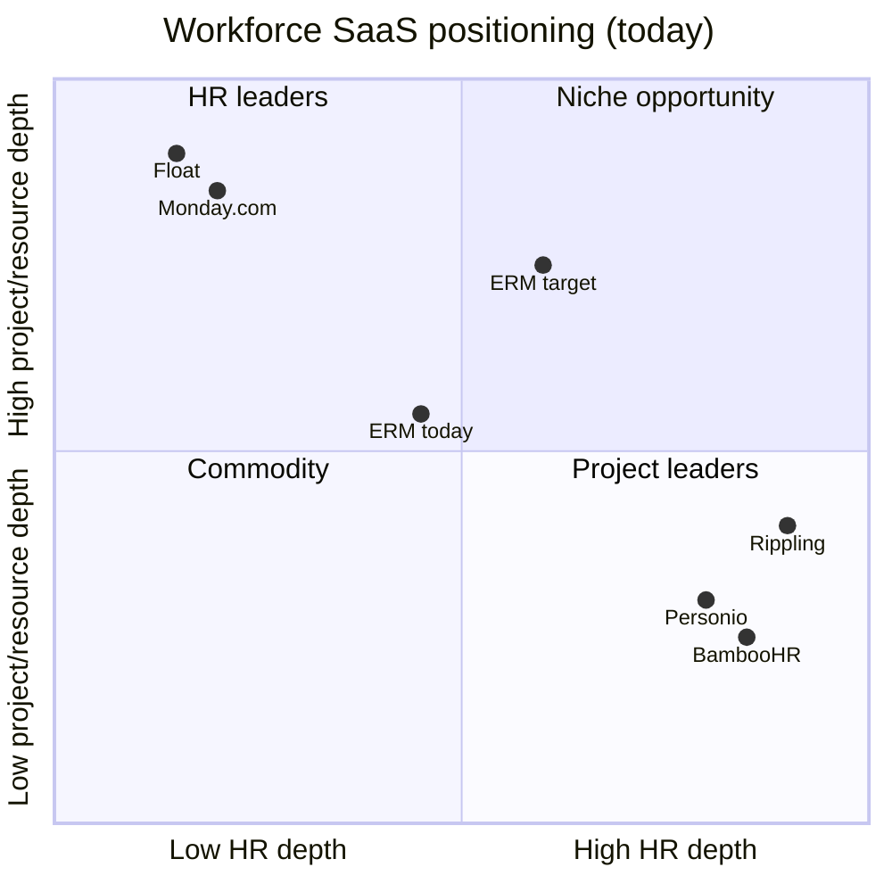

# International SaaS Product Audit — Product Manager Perspective

**Product:** Enterprise Resource Management (ERM)  
**Assessment date:** June 29, 2026  
**Verdict:** Strong **internal / regional MVP** — not yet **international commercial SaaS**

---

## Executive summary

You have a credible **workforce operations core**: employees, departments, projects, tasks, time tracking, leave approvals, search, and RBAC with real multi-tenant isolation on the backend. Engineering quality is above many early-stage products.

For **international-level SaaS**, the gap is not mainly “more CRUD screens.” It is **commercial readiness** (signup, billing, entitlements), **enterprise identity** (SSO, MFA), **privacy/compliance** (GDPR tooling), **product polish** (consistent UX, mobile, accessibility), and **go-to-market differentiation** (why you vs BambooHR, Personio, Monday, Float, Rippling, etc.).

| Dimension | Score | International bar |
|-----------|-------|-------------------|
| Core HR/project workflows | 7/10 | Meets mid-market baseline |
| SaaS commercial model | 2/10 | Blocker |
| Enterprise security | 5/10 | Partial |
| GDPR / privacy | 2/10 | Blocker for EU |
| Design & UX consistency | 6/10 | Mid-migration |
| i18n / localization | 4/10 | EN/FR only, partial |
| Integrations & ecosystem | 1/10 | Major gap |
| Reporting & analytics | 5/10 | Backend ahead of UI |
| Differentiation clarity | 3/10 | Undifferentiated today |

**Honest positioning today:** A solid **B2B workforce ops platform** for SMB/mid-market in France/EU francophone markets, suitable for pilots and single-tenant deployments — not yet ready for global enterprise procurement or EU privacy-heavy sales cycles.

---

## What you already have (strengths)

### Functional core — genuinely usable

- End-to-end **employee, department, project, task** management
- **Time entry** workflow with submit / approve / reject
- **Leave request** workflow with approve / reject / cancel
- **Global search** with CSV/PDF export
- **Dashboard** and resource allocation reporting (partial)
- **5-role RBAC** with documented permission matrix and backend enforcement
- **Multi-org model** with org switcher for users in multiple tenants

### Technical foundation — above average for MVP

- JWT + refresh rotation, httpOnly cookies, login rate limiting
- Org-scoped data isolation in services and repositories
- Flyway migrations, OpenAPI, Actuator/Prometheus, K8s deploy path
- Modern frontend direction: shadcn-style tokens, TanStack tables, dark mode
- EN/FR i18n on core modules

### Product thinking signals

- Empty-state onboarding hints on dashboard
- Keyboard shortcuts overlay (partial)
- Role-based sidebar navigation
- Recent UI modernization (data tables, design tokens)

---

## What blocks “international level”

### Tier 1 — Sales blockers (cannot sell globally without these)

| Gap | Why it matters |
|-----|----------------|
| No self-serve signup / tenant provisioning | Cannot scale acquisition |
| Billing is cosmetic (`FREE` hardcoded) | Not a real SaaS business |
| No SSO / OIDC / SAML | Enterprise RFP disqualifier |
| No MFA | Security questionnaire failure |
| No password reset | Basic product hygiene |
| No GDPR export / erasure | EU sales blocker |
| No persistent audit log | SOC 2 / enterprise trust blocker |
| API contract mismatches in settings | Broken admin flows erode trust |

### Tier 2 — Product quality gaps (churn risk)

| Gap | Why it matters |
|-----|----------------|
| Notifications inbox with no event producers | Feature appears broken |
| Reporting backend rich, UI shows ~30% | Perceived as immature |
| Mixed UI generations (TanStack vs legacy tables) | Feels unfinished |
| i18n incomplete (settings, dashboard charts, aria labels) | Not truly bilingual |
| No RTL, no locale-aware dates/currency | Middle East, Asia expansion blocked |
| Mobile employee experience weak | HR tools are phone-first for employees |
| Route guards inconsistent with RBAC matrix | Security UX confusion |

### Tier 3 — Differentiation gaps (why pick you?)

| Gap | Why it matters |
|-----|----------------|
| No integrations (calendar, payroll, Slack, webhooks) | Stuck as island app |
| No leave balance / accrual engine | HR competitors win on depth |
| No resource planning / capacity forecasting | Project tools win here |
| No AI-assisted insights | Table stakes emerging in 2026 |
| No vertical positioning | “Another HR tool” |

---

## Competitive landscape — where you sit today

| Competitor | Their wedge | Your current gap |
|------------|-------------|------------------|
| **BambooHR / Personio** | HR depth, compliance, employee self-service, payroll integrations | Leave accruals, onboarding, mobile ESS, payroll connectors |
| **Monday / Asana** | Project UX, automations, integrations marketplace | Task UX polish, automations, 100+ integrations |
| **Float / Resource Guru** | Capacity planning, utilization forecasting | No real capacity/forecasting UI |
| **Rippling / Deel** | Global payroll, EOR, device management | No global workforce / payroll story |
| **Odoo / Zoho** | All-in-one + price | Breadth, ecosystem, pricing |
| **Linear** (design benchmark) | Speed, keyboard UX, consistency | UX consistency, command palette, a11y |

**Today you are in the crowded middle:** some HR + some projects + some time — without being best-in-class at any one job.

---

## Differentiation strategy — how to win

International SaaS winners don’t win on “we have employees and projects too.” They win on a **sharp wedge** plus **expansion path**.

### Recommended positioning (pick one primary wedge)

**Option A — “Resource-aware HR for project organizations” (recommended)**  
*For agencies, consultancies, and tech companies that bill by project.*

| Pillar | Differentiation |
|--------|-----------------|
| **Unified story** | One place: who works on what, how long, who’s available, who’s on leave |
| **Capacity intelligence** | Utilization, bench time, project staffing conflicts — Float depth + HR context |
| **Approval workflows** | Time + leave tied to project managers and department heads (you already have this) |
| **Francophone EU first** | Native FR/EN, EU hosting, GDPR-by-design — beat US tools on localization |
| **Mid-market pricing** | Simpler than Workday, deeper than Monday for workforce ops |

**Option B — “Compliance-first workforce ops for regulated SMBs”**  
*For healthcare, finance, public sector in EU.*

Wedge on audit trails, GDPR, SSO, data residency — heavier compliance investment required.

**Option C — “White-label workforce platform for MSPs / HR consultancies”**  
*Sell through partners.*

Tenant branding, multi-org admin, reseller billing — aligns with your multi-tenant backend.

### Differentiation by dimension

| Dimension | How to differentiate | vs competitors |
|-----------|---------------------|----------------|
| **Functionality** | **Project-linked workforce intelligence** — utilization, leave impact on delivery, staffing alerts | BambooHR is HR-only; Float is resourcing-only |
| **Design** | **Linear-grade admin UX** + **BambooHR-simple employee mobile** — finish design system, command palette, fast tables | Beat Odoo/Zoho on polish; match Linear on speed |
| **Security** | **EU-native trust** — GDPR export/erasure in-product, EU data residency option, SSO+MFA day one | Beat US SMB tools on EU procurement |
| **i18n** | **True bilingual product** (not just nav) + locale formats + RTL roadmap | Beat Monday/Asana on FR/EU depth |
| **Integrations** | **Webhook-first + Google/Microsoft calendar + Slack approvals** | Don’t build 100 integrations; build an open core |
| **Pricing** | **Per-seat with project-manager tier** — PMs pay more, employees less | Rippling is expensive; you can undercut with focus |
| **AI (2026)** | **“Staffing copilot”** — “Who can take this project given leave and utilization?” | Novel vs mid-market HR tools |

### What NOT to compete on (short term)

- Full payroll (Rippling, Deel territory)
- Enterprise HCM (Workday, SAP)
- Generic project management (Monday, Asana)
- 100-integration marketplace (unless Series B+)

---

## Roadmap — short, medium, long term

### Short term (0–3 months) — “Trustworthy product”

*Goal: Stop losing deals on basics. Make existing features feel complete.*

| Priority | Initiative | Business impact |
|----------|------------|-----------------|
| P0 | Fix settings API mismatches (profile, org, notifications, billing fields) | Admin trust |
| P0 | Green CI + security integration tests | Engineering credibility |
| P0 | Complete i18n sweep (settings, dashboard, reporting, a11y strings) | FR market credibility |
| P0 | Unify data tables (leave, time entries → TanStack pattern) | Product coherence |
| P0 | Wire notification events (approve/reject/assign → inbox) | Feature actually works |
| P0 | Surface existing reporting APIs in UI | Perceived depth |
| P0 | Remove demo credentials from production login | Security perception |
| P1 | Password reset flow | Basic SaaS hygiene |
| P1 | Leave balance display (API exists, unused) | HR credibility |
| P1 | a11y baseline: focus trap, skip link, replace `window.confirm` | Procurement prep |
| P1 | Project archive/delete UI (backend exists) | Admin completeness |

**Outcome:** A product that **feels finished** for early paying customers in one geography.

---

### Medium term (3–9 months) — “Sellable SaaS”

*Goal: Commercial model + enterprise identity + EU readiness.*

| Priority | Initiative | Business impact |
|----------|------------|-----------------|
| P0 | Self-serve signup + org provisioning wizard | Scalable acquisition |
| P0 | Stripe billing: plans, seats, trials, invoices | Revenue |
| P0 | SSO/OIDC (Azure AD, Google Workspace) + MFA (TOTP) | Enterprise sales |
| P0 | Persistent audit log + admin export | SOC 2 path |
| P0 | GDPR: data export + erasure per user/employee | EU sales |
| P1 | Usage entitlements by plan (seat limits, feature flags) | Monetization |
| P1 | Email notifications (SMTP) for approvals | Workflow completion |
| P1 | Webhooks for key events | Integration ecosystem start |
| P1 | Mobile-responsive employee flows (leave request, time entry) | Employee adoption |
| P1 | Capacity/utilization dashboard (your wedge feature) | Differentiation |
| P1 | Calendar sync (Google/Outlook) for leave | HR table stakes |
| P2 | Role management UI (API exists) | Admin self-service |
| P2 | Server-side table pagination | Scale for 500+ employees |
| P2 | Privacy policy, DPA template, cookie consent | Legal sales support |
| P2 | White-label basics: logo + primary color per org | Partner/reseller path |

**Outcome:** Can run **paid pilots** in EU with security questionnaires that don’t fail immediately.

---

### Long term (9–24 months) — “International scale”

*Goal: Defensible position, expansion markets, certification.*

| Priority | Initiative | Business impact |
|----------|------------|-----------------|
| P0 | SOC 2 Type II program | US/enterprise enterprise |
| P0 | Additional languages (DE, ES, NL, AR + RTL) | Geographic expansion |
| P0 | Data residency options (EU, US regions) | Enterprise/regulated |
| P1 | **Staffing intelligence** — forecasting, bench, project-leave conflicts | Core differentiation |
| P1 | Integration marketplace (Slack, Teams, payroll connectors) | Ecosystem moat |
| P1 | Employee mobile app (PWA or native) | BambooHR parity on ESS |
| P1 | Advanced leave engine (accruals, policies, carry-over) | HR depth |
| P1 | SCIM provisioning | Enterprise IT |
| P2 | AI copilot for resource allocation | 2026 market expectation |
| P2 | API platform + public developer docs | Platform play |
| P2 | ISO 27001 certification | Regulated industries |
| P2 | Partner/reseller portal + white-label full branding | Channel GTM |
| P2 | Multi-entity / subsidiary support | Mid-market enterprise |

**Outcome:** Credible **international mid-market** player in project-based organizations, especially EU.

---

## International readiness checklist

| Requirement | Status | Target |
|-------------|--------|--------|
| Multi-tenant architecture | ✅ Strong | Maintain |
| EN + FR UI | ⚠️ Partial | Full coverage + DE/ES |
| Locale-aware dates/numbers/currency | ❌ | Per-org locale |
| RTL support | ❌ | AR/HE markets |
| Self-serve signup | ❌ | Q2 |
| Subscription billing | ❌ | Q2 |
| SSO + MFA | ❌ | Q2–Q3 |
| GDPR tooling | ❌ | Q3 |
| SOC 2 | ❌ | Q4+ |
| Data residency | ❌ | Year 2 |
| 99.9% SLA + status page | ❌ | Year 1 |
| Customer support (in-app + email) | ⚠️ URLs only | Full tier |
| Legal (ToS, Privacy, DPA) | ❌ | Before EU GA |
| Penetration test | ❌ | Before enterprise GA |

---

## Go-to-market recommendation

### Phase 1 — Beachhead (months 1–6)

- **Geography:** France + francophone EU (Belgium, Switzerland, Luxembourg)
- **Segment:** 50–300 employee **project-based companies** (agencies, IT consultancies, engineering firms)
- **Buyer:** COO / Operations Director / HR + PM hybrid
- **Message:** *“See who’s available, on leave, and on which project — without juggling three tools.”*
- **Pricing:** Freemium or 14-day trial → €8–12/employee/month, PM seats at premium

### Phase 2 — Expand (months 6–12)

- DACH + Benelux (German UI)
- Add compliance story for regulated SMBs
- Partner with HR consultancies (white-label)

### Phase 3 — International (year 2+)

- UK/US with SOC 2
- Integration depth
- AI staffing features as premium tier

---

## KPIs to track international readiness

| Category | Metric | Current (est.) | International target |
|----------|--------|----------------|----------------------|
| Product | Feature completion score | ~65% | 90%+ |
| Commercial | Paying tenants | 0 | 50+ in 12 months |
| Security | Enterprise security questionnaire pass rate | Low | 80%+ |
| UX | WCAG AA audit score | ~40% | 90%+ |
| i18n | Translated string coverage | ~60% | 98%+ |
| Reliability | Uptime | Unknown | 99.9% |
| NPS | Employee admin NPS | Unknown | 40+ |

---

## Bottom line

**Do you have what it takes today?**  
**Not yet for international commercial SaaS** — but you have a **stronger foundation than many products at this stage**. The backend, workflows, and multi-tenancy are real. The gap is **commercialization, enterprise trust, product polish, and a clear wedge**.

**Highest-leverage sequence:**

1. **Short term:** Finish what you built (fix broken settings, notifications, reporting UI, design consistency)
2. **Medium term:** Become a real SaaS (billing, signup, SSO, GDPR) + ship **capacity/utilization** as your differentiator
3. **Long term:** EU-first expansion → certifications → AI staffing intelligence → integration ecosystem

**Your best differentiation bet:** Don’t be “another HR tool.” Be **the workforce operations platform for organizations that live and die by project delivery** — with EU-native trust, bilingual depth, and resource intelligence that BambooHR and Float each only do half of.

---

## Related documentation

| Document | Path |
|----------|------|
| Technical audit | [AUDIT_REPORT.md](./AUDIT_REPORT.md) |
| Implementation roadmap | [IMPLEMENTATION_PLAN.md](./IMPLEMENTATION_PLAN.md) |
| Short-term sprint | [SHORT_TERM_IMPLEMENTATION_PLAN.md](./SHORT_TERM_IMPLEMENTATION_PLAN.md) |
| Medium-term sprint | [MEDIUM_TERM_IMPLEMENTATION_PLAN.md](./MEDIUM_TERM_IMPLEMENTATION_PLAN.md) |
| RBAC reference | [../backend/docs/ROLES_AND_PERMISSIONS.md](../backend/docs/ROLES_AND_PERMISSIONS.md) |
| Security test plan | [SECURITY_TEST_PLAN.md](./SECURITY_TEST_PLAN.md) |
| Backend/frontend gaps | [../backend/docs/BACKEND_FRONTEND_GAP_ANALYSIS.md](../backend/docs/BACKEND_FRONTEND_GAP_ANALYSIS.md) |

---

## Follow-up artifacts (optional)

- Prioritized PRD backlog mapped to codebase gaps
- Competitive battlecard (ERM vs Personio vs Float)
- Security questionnaire prep doc for enterprise sales
- Pricing & packaging model with tier definitions tied to current feature set
